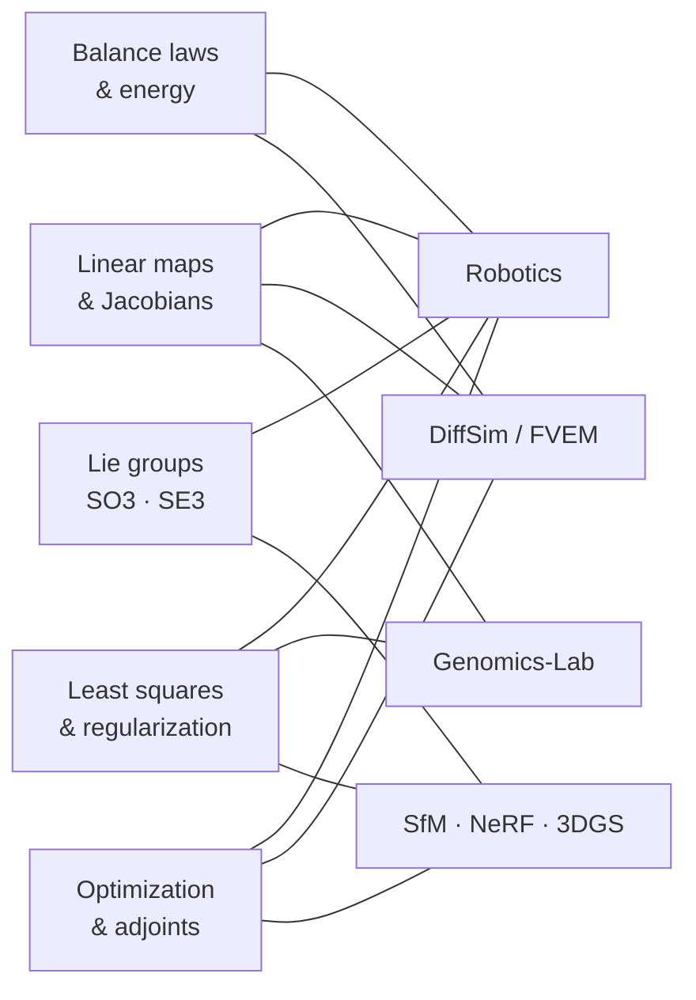

# Math bridges

> **Hook:** Robotics, finite elements, genomic prediction and 3D reconstruction run on the same five pieces of math. Learn each piece once; recognize it everywhere.

## The five shared pieces

## Bridge table (grows with every module)

| Robotics idea | Equation | DiffSim / FVEM | Genomics-Lab | 3D vision | Module |
|---|---|---|---|---|---|
| Configuration space / DOF | \(\text{dof}=m(N-1-J)+\sum f_i\) | number of unknowns minus constraints = free DOFs of the mesh | effective number of parameters \(\mathrm{tr}(H)\) | camera has 6 DOF, scene points 3 each | M1 |
| Constraints shrink the space | \(g(q)=0\) | Dirichlet BCs remove nodes | sum-to-zero constraints on effects | gauge freedom in bundle adjustment (fix 7 DOF) | M1 |
| Rotation is orthogonal | \(R^\top R=I,\ \det R=1\) | rotation of local element frames | PCA loadings are orthogonal | camera rotation | M2 |
| Exponential map | \(R=e^{[\hat\omega]\theta}\) | \(u(t)=e^{-Kt}u_0\) for linear ODE \(\dot u=-Ku\) | — | pose update in SLAM / 3DGS pose refinement | M2 |
| Twist & screw | \(\dot T=T[\mathcal V_b]\) | velocity field of a rigid region | — | camera motion between frames | M2 |
| Jacobian | \(\mathcal V=J(\theta)\dot\theta\) | sensitivity \(\partial u/\partial p\) | design matrix \(X\) | reprojection Jacobian | M4 |
| Damped least-squares IK | \(\Delta\theta=J^\top(JJ^\top+\lambda^2I)^{-1}e\) | Tikhonov-regularized inverse problem | ridge / GBLUP \(\hat\beta=(X^\top X+\lambda I)^{-1}X^\top y\) | Levenberg–Marquardt in BA | M5 |
| Statics duality | \(\tau=J^\top\mathcal F\) | adjoint: \(\nabla_p L=(\partial u/\partial p)^\top\lambda\) | — | backprop through renderer | M4 |
| Mass matrix | \(M(\theta)\ddot\theta+c+g=\tau\) | \(M\ddot u+Ku=f\) | — | — | M7 |
| Kalman filter | \(\hat x^+=\hat x+K(y-H\hat x)\) | data assimilation | BLUP is the same Gaussian conditioning | visual-inertial odometry | Track C |

!!! tip "The single sentence that ties it together"
    **Damped least-squares IK, ridge-regression GBLUP, Tikhonov inverse problems and Levenberg–Marquardt bundle adjustment are the same equation** — solve \(\min\|Ax-b\|^2+\lambda^2\|x\|^2\). Only the names of \(A\), \(x\), \(b\) change.

## How to use this page

When a module introduces an equation, its "Math bridges" block adds a row here. Over time this table becomes the one-page summary of how all my labs connect.
