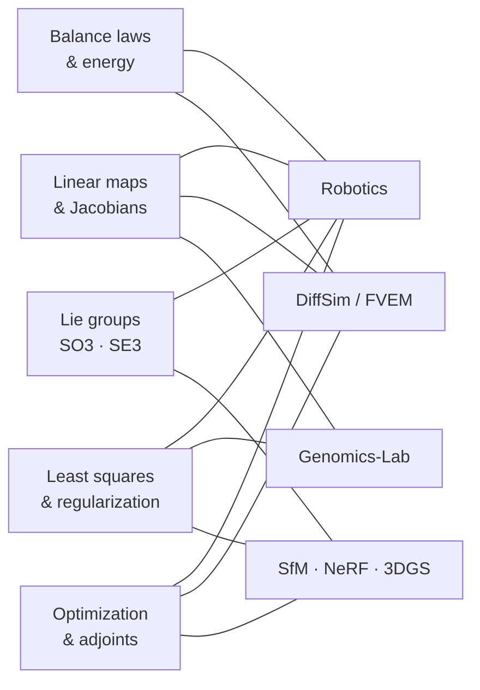

# Math bridges

> **Hook:** Robotics, finite elements, genomic prediction and 3D reconstruction run on the same five pieces of math. Learn each piece once; recognize it everywhere.

## The five shared pieces

## Bridge table (grows with every module)

| Robotics idea | Equation | DiffSim / FVEM | Genomics-Lab | 3D vision | Module |
|---|---|---|---|---|---|
| Configuration space / DOF | \(\text{dof}=m(N-1-J)+\sum f_i\) | number of unknowns minus constraints = free DOFs of the mesh | effective number of parameters \(\mathrm{tr}(H)\) | camera has 6 DOF, scene points 3 each | M1 |
| Constraints shrink the space | \(g(q)=0\) | Dirichlet BCs remove nodes | sum-to-zero constraints on effects | gauge freedom in bundle adjustment (fix 7 DOF) | M1 |
| Rotation is orthogonal | \(R^\top R=I,\ \det R=1\) | rotation of local element frames | PCA loadings are orthogonal | camera rotation | M2 |
| Exponential map | \(R=e^{[\hat\omega]\theta}\) | \(u(t)=e^{-Kt}u_0\) for linear ODE \(\dot u=-Ku\) | — | pose update in SLAM / 3DGS pose refinement | M2 |
| Twist & screw | \(\dot T=T[\mathcal V_b]\) | velocity field of a rigid region | — | camera motion between frames | M2 |
| Jacobian | \(\mathcal V=J(\theta)\dot\theta\) | sensitivity \(\partial u/\partial p\) | design matrix \(X\) | reprojection Jacobian | M4 |
| Damped least-squares IK | \(\Delta\theta=J^\top(JJ^\top+\lambda^2I)^{-1}e\) | Tikhonov-regularized inverse problem | ridge / GBLUP \(\hat\beta=(X^\top X+\lambda^2 I)^{-1}X^\top y\) | Levenberg–Marquardt in BA | M5 |
| Statics duality | \(\tau=J^\top\mathcal F\) | adjoint: \(\nabla_p L=(\partial u/\partial p)^\top\lambda\) | — | backprop through renderer | M4 |
| Mass matrix | \(M(\theta)\ddot\theta+c+g=\tau\) | \(M\ddot u+Ku=f\) | — | — | M7 |
| Kalman filter | \(\hat x^+=\hat x+K(y-H\hat x)\) | data assimilation | BLUP is the same Gaussian conditioning | visual-inertial odometry | Track C |
| Product of exponentials (forward kinematics) | \(T=e^{[\mathcal S_1]\theta_1}\cdots e^{[\mathcal S_n]\theta_n}M\) | operator splitting: a step as a product of sub-step exponentials; reference configuration + displacement | baseline + effects | chained camera extrinsics; turntable scan is a 1-joint PoE | M3 |
| PoE vs DH conditioning | parallel axes make DH parameters jump | choosing a well-conditioned parameterization | collinear markers (LD) give unstable effects | gauge choice in BA | M3 |
| Space Jacobian columns = carried screw axes | \(J_{s,i}=\Ad_{e^{[\mathcal S_1]\theta_1}\cdots e^{[\mathcal S_{i-1}]\theta_{i-1}}}\mathcal S_i\) | sensitivity \(\partial u/\partial p\); strain–displacement \(B\) | design matrix \(X\) | reprojection Jacobian in BA | M4 |
| Manipulability ellipse | axes \(\sigma_i=\sqrt{\lambda_i(JJ^\top)}\) | eigen lens on \(K=B^\top DB\) | eigenvalues of \(G\propto ZZ^\top\) (population-structure PCA) | BA normal matrix \(J^\top J\) conditioning | M4 |
| Redundancy / null space | \(\dot\theta=J^\dagger v+(I-J^\dagger J)z\) | zero-energy (rigid-body) modes | non-identifiable effects | scale/gauge directions in SfM | M4 |
| Newton–Raphson IK | \(\theta\leftarrow\theta+J_b^\dagger\mathcal V_b,\ [\mathcal V_b]=\log(T_{sb}^{-1}T_{sd})\) | Newton for nonlinear FEM, quadratic convergence on log-error plots | — | Gauss–Newton in BA; pose residual as a log | M5 |
| Push-through identity | \((J^\top J+\lambda^2I)^{-1}J^\top=J^\top(JJ^\top+\lambda^2I)^{-1}\) | primal vs dual form of a regularized solve | RR-BLUP (markers) = GBLUP (lines, \(G=XX^\top/k\)) | Schur-complement reduction in BA | M5 |
| Null-space secondary task | \(\Delta\theta=J^\dagger e+(I-J^\dagger J)z\) | constraint-preserving updates | non-estimable functions of effects | gauge freedom | M5 |
| Loop closure | \(g(\theta)=0,\ H\dot\theta=0\) | multi-point / Dirichlet constraints \(Bu=\bar u\) | sum-to-zero constraints | pose-graph loop closure | M6 |
| Lagrange multipliers & saddle point | \(\begin{bmatrix}K&H^\top\\H&0\end{bmatrix}\begin{bmatrix}\Delta\theta\\\lambda\end{bmatrix}=\begin{bmatrix}f\\0\end{bmatrix}\) | mixed FEM (Stokes, contact, weak BCs), inf–sup stability | constrained least squares (KKT) | gauge-fixing constraints in BA | M6 |
| Redundant constraints ↔ rank deficiency | \(\operatorname{rank}H<\#\text{rows}\) | over-constrained BCs, non-unique reactions | confounded effects | unfixed gauge, singular normal equations | M6 |
| Energy-preserving structure | \(\dot E=\dot\theta^\top\tau\), \(\dot M-2C\) skew | discrete energy estimates; symplectic (Störmer–Verlet, Newmark) vs explicit RK time stepping | — | — | M7 |
| Inverse dynamics is linear in parameters | \(\tau=Y(\theta,\dot\theta,\ddot\theta)\,\pi\) | parameter estimation / inverse problems with adjoints | \(y=X\beta\); ridge/GBLUP when data are few | physical parameters from video via differentiable sim | M7 |
| RNEA out–back sweep | velocities out with \(\Ad\), wrenches back with \(\Ad^\top\) | forward solve + adjoint solve | — | backprop through a renderer | M7 |
| Cubic via-point segments | \(\theta=H_1\theta_j+H_2\Delta T\dot\theta_j+H_3\theta_{j+1}+H_4\Delta T\dot\theta_{j+1}\) | Hermite cubic beam shape functions | smoothing splines for growth curves | B-spline camera trajectories | M8 |
| Smoothness penalty | \(\min\int\lVert\dddot\theta\rVert^2dt\) | regularized weak form / bending energy | ridge \(\lambda\lVert\beta\rVert^2\), spline \(\lambda\int f''^2\) | pose smoothness priors | M8 |
| Screw interpolation | \(X(s)=X_0\exp(\log(X_0^{-1}X_1)s)\) | — | — | Lie-algebra camera interpolation (deblur / rolling-shutter NeRF) | M8 |
| Grid search wavefront | \(g(m)=\min(g(n)+c(n,m))\) | discrete eikonal \(\lVert\nabla T\rVert=1\); fast marching; SDF in shifted boundary method | — | geodesic distance on point-cloud graphs; TSDF / SDF fields | M9 |
| Trajectory optimization | \(\min_\xi \sum\lVert q_{k+1}-2q_k+q_{k-1}\rVert^2+\lambda\sum c_{\text{obs}}(q_k)\) | PDE-constrained optimization; second difference = 1D stiffness (Laplacian) matrix | spline / smoothing penalties | camera-path smoothing; constrained least squares in BA | M9 |
| Sampling planners | \(\Pr[\text{fail}]\to0\) as \(N\to\infty\) | Monte Carlo, error \(\sim N^{-1/2}\) | MCMC in Bayesian genomic models | RANSAC | M9 |
| PD error dynamics | \(I\ddot e+(b+K_d)\dot e+K_pe=0,\ \omega_n=\sqrt{K_p/I},\ \zeta=\tfrac{b+K_d}{2\sqrt{K_pI}}\) | one damped mode of \(M\ddot u+C\dot u+Ku=0\); closed-loop eigenvalues ↔ time-stepper stability | — | — | M10 |
| Gain tuning | choose \(K_p,K_i,K_d\) | — | hyperparameter tuning of \(\lambda\) (CV / Bayesian optimization) | learning-rate / momentum tuning | M10 |
| Impedance control | \(M_d\ddot x+B\dot x+K(x-x_d)=-f_{\text{ext}}\) | penalty contact / penalty BCs | — | — | M10 |
| Contact complementarity | \(g\ge0,\ \lambda_n\ge0,\ g\lambda_n=0\) | Signorini contact conditions (penalty / Lagrange / augmented Lagrangian) | — | — | M11 |
| Friction cone & force closure | \(\lVert f_t\rVert\le\mu f_n\); origin inside hull of edge wrenches | Coulomb friction in contact FEM; second-order cone constraints | nonnegative / constrained least squares | densities and opacities kept \(\ge0\) in NeRF/3DGS | M11 |
| Exact odometry on SE(2) | \(T_{k+1}=T_k e^{[\mathcal V_b]\Delta t}\) | exponential/geometric integrators vs forward Euler (global error \(O(\Delta t)\)) | — | camera pose chaining in VO / SfM / VGGT; drift without loop closure | M12 |
| Lie bracket & controllability | \([g_1,g_2]=\frac{\partial g_2}{\partial q}g_1-\frac{\partial g_1}{\partial q}g_2\) | operator-splitting (commutator) error | — | non-commuting rotations in pose updates | M12 |
| Quadrotor Newton–Euler | \(m\ddot p=-mge_3+fRe_3,\ J\dot\omega+\omega\times J\omega=\tau\) | rigid-body ODE with RK4 time stepping | — | IMU propagation between frames | Track B |
| Attitude error on SO(3) | \(e_R=\tfrac12(R_d^\top R-R^\top R_d)^\vee=\sin\theta\,\hat\omega\) | — | — | rotation residual in pose graphs / BA | Track B |
| Flow needs height for scale | flow \(\approx v/h-\omega\) | — | — | monocular SfM scale ambiguity | Track B |
| Kalman update = Gaussian conditioning | \(K=P^-H^\top(HP^-H^\top+R)^{-1}\) | EnKF data assimilation (e.g. APSIM LAI, soil moisture) | BLUP \(\hat u=GZ^\top(ZGZ^\top+\sigma_e^2I)^{-1}(y-X\hat\beta)\), \(G=\operatorname{Var}(u)\) | visual-inertial odometry | Track C |
| Covariance propagation | \(P^-=FPF^\top+Q\) | uncertainty through a linear time step | variance of a linear combination | — | Track C |
| SLAM factor graph | \(\min\sum\lVert r\rVert^2_{\Sigma^{-1}}\), sparse Gauss–Newton | sparse FE assembly | Henderson mixed-model equations | bundle adjustment (COLMAP), 3DGS SLAM | Track C |
| Behavior cloning | \(\min_\phi\sum\lVert a_t-\mu_\phi(o_t)\rVert^2\) | fitting a surrogate to solver runs | GBLUP regresses phenotype on markers | VGGT regresses poses from images | Track D |
| Covariate shift / DAgger | \(d_{\pi^\star}\ne d_\pi\) | surrogate queried outside its training range | accuracy drop across populations / G×E | NeRF fails far from training views | Track D |
| Diffusion / flow policy | \(a^{k-1}=\alpha_k(a^k-\gamma_k\varepsilon_\phi)+\sigma_kz\) | iterative solvers, pseudo-time stepping | — | NeRF / 3DGS optimization from random init | Track D |
| One regularized least-squares equation | \(x_\lambda=(A^\top A+\lambda^2I)^{-1}A^\top b\) | Tikhonov inverse problem | ridge / GBLUP | LM in bundle adjustment | Track E |
| Prior = regularizer | \(\lambda^2=\sigma_e^2/\sigma_x^2\), \(\mathrm{Cov}=\sigma_e^2(A^\top A+\lambda^2I)^{-1}\) | Bayesian inversion / UQ | heritability sets λ; REML | pose covariance | Track E |
| System ID is linear in parameters | \(\tau=Y(\theta,\dot\theta,\ddot\theta)\pi\) | \(K(p)=\sum p_iK_i\) | \(y=X\beta+e\) | — | Track E |

!!! tip "The single sentence that ties it together"
    **Damped least-squares IK, ridge-regression GBLUP, Tikhonov inverse problems and Levenberg–Marquardt bundle adjustment are the same equation** — solve \(\min\|Ax-b\|^2+\lambda^2\|x\|^2\). Only the names of \(A\), \(x\), \(b\) change.

!!! note "One λ convention on this page"
    Every row writes the penalty as \(\lambda^2\lVert x\rVert^2\), so \(\lambda^2=\sigma_e^2/\sigma_\beta^2\) (or \(\sigma_e^2/\sigma_g^2\) with unit-diagonal \(G\)) and filter factors are \(\sigma_i^2/(\sigma_i^2+\lambda^2)\). Genomics papers and LM codes usually write \(\lambda\lVert x\rVert^2\); their \(\lambda\) is our \(\lambda^2\) (M5's own GBLUP table uses that form). Also: \(Z\) is a marker matrix in the M4 row but an incidence matrix in the Track C row; \(G\) is a unit-scaled kinship in M5/Track E but the covariance \(\operatorname{Var}(u)\) in the Track C BLUP row.

## How to use this page

When a module introduces an equation, its "Math bridges" block adds a row here. Over time this table becomes the one-page summary of how all my labs connect.
