# Robotics Learning Lab

> **Hook:** A robot is a moving coordinate frame that has to agree with the world. Every chapter of robotics answers one question: *where is the frame, how fast is it moving, what pushes it, and how do we make it go where we want?*

This lab is an interactive companion to **Kevin M. Lynch & Frank C. Park, *Modern Robotics: Mechanics, Planning, and Control*** (Cambridge, 2017). It follows the book chapter by chapter, then extends into the four tracks I actually build with: **manipulation (SO-ARM101), aerial (Crazyflie / under-canopy drone), ground rover (Jetson Orin), and physical AI**.

Its sister labs use the same layout, so the same idea keeps showing up in different clothes:

| Lab | What it teaches | Where robotics meets it |
|---|---|---|
| [DiffSim-Lab](https://znjubery.github.io/DiffSim-Lab/) | Differentiable FEM, weak forms, adjoints | Jacobians, adjoint maps, sensitivity of a pose to a joint |
| [FVEM repo](https://github.com/znjubery/fvem) | FEM → FVM → FVEM → operator learning | Conservation laws ↔ wrench balance, time stepping ↔ integrating twists |
| Genomics-Lab | GBLUP, ridge, multi-omic ML | Damped least-squares IK *is* ridge regression |
| 3D vision short course | SfM, NeRF, 3DGS | Every camera pose is an \(\SE(3)\) matrix from Module 2 |

## How each module is built

Every module has the same 12 blocks, so you always know where to look:

1. **Hook** — one sentence you can say out loud.
2. **Intuition first** — one everyday analogy, one story thread.
3. **Problem → math basic → move → result** — the logic in four lines.
4. **Picture it** — a live widget. *Every number is computed in your browser.*
5. **Step-by-step derivation** — with *why this move* and *what if we didn't*.
6. **Math bridges** — the same equation in DiffSim, FVEM, genomics, 3D vision.
7. **In your robots** — SO-ARM101, Crazyflie, rover, turntable scanner.
8. **Current research** — what labs are doing now (with links).
9. **Challenges** — what still breaks.
10. **Next five years** — where it is heading.
11. **Check yourself** — answers saved in your browser.
12. **One-line version** — the sentence to retell.

## Where we are

```mermaid
flowchart LR
  S0([Step 0<br/>Scaffold + roadmap]):::done --> M1([M1 C-space<br/>Ch 2]):::done
  M1 --> M2([M2 Rigid motions<br/>Ch 3]):::now
  M2 --> M3([M3 Forward kinematics<br/>Ch 4]):::todo
  M3 --> M4([M4 Velocity & Jacobian<br/>Ch 5]):::todo
  M4 --> M5([M5 Inverse kinematics<br/>Ch 6]):::todo
  M5 --> M6([M6–M12<br/>Ch 7–13]):::todo
  M6 --> T([Tracks B–E<br/>aerial · rover · physical AI]):::todo
  classDef done fill:#2e7d32,color:#fff,stroke:#1b5e20
  classDef now fill:#f9a825,color:#000,stroke:#f57f17
  classDef todo fill:#eceff1,color:#37474f,stroke:#90a4ae
```

Green = written, amber = awaiting your review, grey = planned. The full chapter map is on the [Roadmap](roadmap.md).

