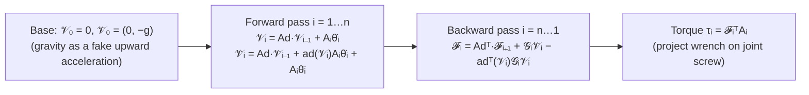

# M7 · Dynamics of open chains

Lynch & Park Ch 8 Used in: torque control, simulation, gravity compensation, RL simulators Tracks: B, D, E

> **Hook:** Kinematics says where the arm goes; dynamics says what it costs to get there — and one equation, \(M(\theta)\ddot\theta + c(\theta,\dot\theta) + g(\theta) = \tau\), is the robot's version of \(F = ma\), with the same shape as the FEM equation \(M\ddot u + Ku = f\).

## Intuition first

**The playground swing.** Push a child on a swing and you feel all of robot dynamics in your hands:

1. **Heaviness depends on pose.** A child sitting tucked is easier to swing than one leaning back with legs out. Same mass, different spread → the **mass matrix** \(M(\theta)\) changes with configuration.
2. **Swinging makes its own forces.** At the bottom the ropes pull harder than the child's weight; when the child pumps their legs, the seat speeds up or slows down. These velocity-made forces are the **Coriolis and centripetal** terms \(c(\theta,\dot\theta)\).
3. **Gravity always pulls back to the bottom** → \(g(\theta)\).
4. **Your push** is the joint torque \(\tau\). Push in time and the energy grows; stop pushing and an ideal swing keeps exactly the same energy forever. Real swings slow down (friction).

A 2R arm hanging under gravity is a *double* swing: the upper link is the rope, the lower link is the child's legs. The rest of the page builds that double swing's equation, checks its energy, and simulates it.

## Problem → math basic → move → result

1. **Problem.** Given joint torques \(\tau\), how does the arm move (**forward dynamics**)? Given a desired motion \(\theta(t)\), what torques make it happen (**inverse dynamics**)?
2. **Math basic.** Energy. Kinetic energy \(\mathcal K = \tfrac12\dot\theta^\top M(\theta)\dot\theta\), potential energy \(\mathcal P(\theta)\), Lagrangian \(\mathcal L = \mathcal K - \mathcal P\).
3. **Move.** Apply the Euler–Lagrange equation \(\frac{d}{dt}\frac{\partial\mathcal L}{\partial\dot\theta} - \frac{\partial\mathcal L}{\partial\theta} = \tau\). For big chains, use the equivalent Newton–Euler recursion with twists and wrenches from M2.
4. **Result.** \(\tau = M(\theta)\ddot\theta + c(\theta,\dot\theta) + g(\theta)\): \(n\) coupled second-order ODEs. Inverse dynamics in \(O(n)\) work; forward dynamics by solving \(M\ddot\theta = \tau - c - g\).

## Part 1 — Lagrangian derivation for the 2R arm

Model (L&P Example 8.1): point masses \(m_1, m_2\) at the ends of links of length \(L_1, L_2\); angles from the horizontal \(x\)-axis; gravity \(-g\hat y\). Shorthand \(c_1=\cos\theta_1\), \(s_2=\sin\theta_2\), \(c_{12}=\cos(\theta_1+\theta_2)\).

**Step 1 — positions** (this is M3's forward kinematics):

\[
x_1 = L_1c_1,\quad y_1 = L_1s_1,\qquad x_2 = x_1 + L_2c_{12},\quad y_2 = y_1 + L_2s_{12}
\]

**Step 2 — kinetic energy.** Differentiate and square. The cross term \(2L_1L_2\cos\theta_2\) appears because the two velocity contributions add like vectors:

\[
\mathcal K = \tfrac12(m_1+m_2)L_1^2\dot\theta_1^2 + \tfrac12 m_2\!\left(L_2^2(\dot\theta_1+\dot\theta_2)^2 + 2L_1L_2c_2\,\dot\theta_1(\dot\theta_1+\dot\theta_2)\right)
\]

*Why this move:* \(\mathcal K\) is a quadratic form in \(\dot\theta\), so we can read off a matrix: \(\mathcal K = \tfrac12\dot\theta^\top M(\theta)\dot\theta\).

\[
M(\theta) = \begin{bmatrix} m_1L_1^2 + m_2(L_1^2 + 2L_1L_2c_2 + L_2^2) & m_2(L_1L_2c_2 + L_2^2)\\ m_2(L_1L_2c_2 + L_2^2) & m_2L_2^2\end{bmatrix}
\]

Only \(\theta_2\) appears: stretching the elbow out (\(c_2=1\)) makes the shoulder "heavier", just like the leaning-back child.

**Step 3 — potential energy:** \(\mathcal P = m_1 g y_1 + m_2 g y_2 = (m_1+m_2)gL_1s_1 + m_2 g L_2 s_{12}\).

**Step 4 — Euler–Lagrange.** Compute \(\frac{d}{dt}\partial\mathcal L/\partial\dot\theta_i - \partial\mathcal L/\partial\theta_i = \tau_i\) and sort the terms by type:

\[
\tau = M(\theta)\ddot\theta + \underbrace{\begin{bmatrix} -m_2L_1L_2s_2(2\dot\theta_1\dot\theta_2 + \dot\theta_2^2)\\ m_2L_1L_2s_2\,\dot\theta_1^2\end{bmatrix}}_{c(\theta,\dot\theta)} + \underbrace{\begin{bmatrix}(m_1+m_2)L_1gc_1 + m_2gL_2c_{12}\\ m_2gL_2c_{12}\end{bmatrix}}_{g(\theta)}
\]

*Why this move:* grouping by "times \(\ddot\theta\)", "times two velocities", and "no velocity" gives three terms with three different physical meanings, and the same grouping works for any \(n\).

- \(\dot\theta_1^2\) terms are **centripetal** (the rope pulling harder at the bottom).
- \(\dot\theta_1\dot\theta_2\) terms are **Coriolis** (pumping legs while swinging).
- Example values \(m_1=m_2=1\) kg, \(L_1=1\), \(L_2=0.8\) m, arm straight out horizontally: \(g(\theta) = (2\cdot1\cdot9.81 + 0.8\cdot9.81,\ 0.8\cdot9.81) = (27.5,\ 7.8)\) N·m. The shoulder holds 3.5× the elbow's load — why shoulder servos run hottest.

??? question "What if we skipped the Coriolis terms?"
    At low speed nobody notices: \(c\) is quadratic in \(\dot\theta\), so halving speed cuts it 4×. But a fast swing of the example arm at \(\dot\theta_1 = 3\) rad/s with \(\theta_2 = 90°\) gives an elbow torque \(m_2L_1L_2\dot\theta_1^2 = 7.2\) N·m — about the same as holding the forearm against gravity. Controllers that drop \(c\) track slow moves fine and overshoot fast ones (M10's computed-torque control keeps it).

## Part 2 — Two properties that always hold

The general form is \(M(\theta)\ddot\theta + C(\theta,\dot\theta)\dot\theta + g(\theta) = \tau\), where \(c = C\dot\theta\) and \(C\) is built from the **Christoffel symbols** \(\Gamma_{ijk} = \tfrac12\left(\frac{\partial m_{ij}}{\partial\theta_k} + \frac{\partial m_{ik}}{\partial\theta_j} - \frac{\partial m_{jk}}{\partial\theta_i}\right)\).

**Property 1 — \(M(\theta)\) is symmetric positive definite.** \(\mathcal K = \tfrac12\dot\theta^\top M\dot\theta > 0\) for every \(\dot\theta\ne0\): anything that moves has positive kinetic energy. So \(M^{-1}\) always exists and forward dynamics never divides by zero.

**Property 2 — \(\dot M - 2C\) is skew-symmetric.** For the 2R arm, with \(\kappa = m_2L_1L_2s_2\):

\[
\dot M - 2C = \begin{bmatrix} 0 & \kappa(2\dot\theta_1 + \dot\theta_2)\\ -\kappa(2\dot\theta_1+\dot\theta_2) & 0\end{bmatrix}
\]

*Why it matters:* the power balance. Differentiate the total energy \(E = \mathcal K + \mathcal P\):

\[
\dot E = \dot\theta^\top M\ddot\theta + \tfrac12\dot\theta^\top\dot M\dot\theta + \dot\theta^\top g = \dot\theta^\top\tau + \tfrac12\dot\theta^\top(\dot M - 2C)\dot\theta = \dot\theta^\top\tau
\]

A skew matrix gives \(x^\top Sx = 0\), so the Coriolis terms **move energy around but never create it**. Power in = joint velocity × torque, exactly as on the swing. With damping \(\tau = -b\dot\theta\): \(\dot E = -b\lVert\dot\theta\rVert^2 \le 0\). This one line is how M10 proves PD control is stable.

## Part 3 — Watch energy: simulate the double swing

Forward dynamics: \(\ddot\theta = M(\theta)^{-1}\left(\tau - c(\theta,\dot\theta) - g(\theta)\right)\). Write it as a first-order system \(x = (\theta,\dot\theta)\), \(\dot x = f(x)\), and pick a time stepper:

| Stepper | Update | Order | Energy over long runs |
|---|---|---|---|
| Explicit Euler | \(x_{k+1} = x_k + h f(x_k)\) | 1 | grows steadily (spirals out) |
| Symplectic Euler | \(p_{k+1} = p_k - h\,\partial_\theta H(\theta_k, p_{k+1})\), \(\theta_{k+1} = \theta_k + h M^{-1}p_{k+1}\) | 1 | oscillates, stays **bounded** |
| RK4 | 4 slope samples, weights \(\tfrac16(1,2,2,1)\) | 4 | tiny per step, but slowly drifts |

Here \(p = M(\theta)\dot\theta\) is the joint momentum and \(H = \tfrac12 p^\top M^{-1}p + \mathcal P\) the Hamiltonian. *Why the momentum form:* symplectic methods preserve phase-space area of \((\theta, p)\) — not \((\theta,\dot\theta)\) — and that is what keeps a nearby "shadow" energy exactly conserved.

Try: start at θ₁ = 30°, θ₂ = 0 with h = 0.01 s. Explicit Euler's drift climbs to ~100% in 20 s; symplectic Euler wiggles at a few %; RK4 sits near 10⁻⁴. Halve h and RK4's error falls ~16–32×. Then set damping b > 0 and watch E fall as \(-b\lVert\dot\theta\rVert^2\) predicts. The readout also checks \(M\) is positive definite and \(\dot M - 2C\) is skew at every instant.

Numbers I checked offline (node, same code, start 30°/0°, \(\tau=0\), \(b=0\)): over 20 s, max relative energy error (scaled by \((m_1+m_2)g(L_1+L_2) = 35.3\) J) was Euler 1.25 / 0.57 at \(h\) = 0.01 / 0.005; symplectic 0.094 / 0.048; RK4 1.4×10⁻⁴ / 4.3×10⁻⁶. Over 500 s at \(h=0.02\) on the chaotic swing, RK4 drifted to −0.21 while symplectic Euler stayed within ±0.07. **Order wins short races; structure wins long ones.**

??? warning "Energy conservation is a test, not a proof"
    Constant energy shows your \(M\), \(c\), \(g\) are *consistent* with one Lagrangian. It cannot catch a wrong mass value — a wrong but self-consistent model also conserves its own energy. Check the static pose too: with the arm hanging straight down, \(g(\theta) = 0\) and nothing should move.

## Part 4 — Bigger chains: spatial inertia and Newton–Euler

**Spatial inertia.** One rigid body, body frame at its centre of mass:

\[
\mathcal G_b = \begin{bmatrix}\mathcal I_b & 0\\ 0 & mI\end{bmatrix}\in\R^{6\times6},\qquad \mathcal K = \tfrac12\mathcal V_b^\top\mathcal G_b\mathcal V_b
\]

\(\mathcal I_b\) is the \(3\times3\) rotational inertia. The Newton–Euler equation of one body becomes one 6-vector equation using M2's twists and wrenches:

\[
\mathcal F_b = \mathcal G_b\dot{\mathcal V}_b - [\mathrm{ad}_{\mathcal V_b}]^\top\mathcal G_b\mathcal V_b
\]

The second term holds \(\omega\times\mathcal I\omega\) — the gyroscopic wobble of a spinning drone.

**Recursive Newton–Euler (inverse dynamics, \(O(n)\)).**

*Why this move:* velocities flow **out** from the base with \(\Ad\); forces flow **back** with \(\Ad^\top\) — the exact pairing from M2 Part 6. Each link is touched twice, so the cost is \(O(n)\), against \(O(n^3)\) or worse for building \(M\) symbolically.

**Forward vs inverse dynamics.**

| | Input | Output | Cost | Used for |
|---|---|---|---|---|
| Inverse | \(\theta,\dot\theta,\ddot\theta\) | \(\tau\) | \(O(n)\) (RNEA) | feedforward control, gravity compensation, system ID |
| Forward | \(\theta,\dot\theta,\tau\) | \(\ddot\theta\) | \(O(n)\) (articulated-body algorithm) or \(O(n^3)\) via \(M^{-1}\) | simulation, RL, model-predictive control |

Trick: run RNEA \(n\) times with \(\ddot\theta = e_i\) and \(\dot\theta = 0\), \(g=0\) — each run returns column \(i\) of \(M(\theta)\).

**Linear in the parameters.** Every term is linear in the masses, first moments and inertias, so \(\tau = Y(\theta,\dot\theta,\ddot\theta)\,\pi\) with \(\pi\in\R^{10n}\). Logging \(\tau\) and motion and solving least squares for \(\pi\) is **system identification** — the same algebra as regressing a trait on a genotype matrix.

## Math bridges

| Here | DiffSim / FVEM | Genomics-Lab | 3D vision |
|---|---|---|---|
| \(M(\theta)\ddot\theta + c + g = \tau\) | semi-discrete FEM \(M\ddot u + Ku = f\); robot \(M\) is small, dense and configuration-dependent, FEM \(M\) is large, sparse and constant | — | — |
| \(M\) symmetric positive definite from \(\mathcal K = \tfrac12\dot\theta^\top M\dot\theta\) | consistent mass matrix \(M_{ij} = \int\rho N_iN_j\) is SPD from the same energy argument; lumped mass = diagonal approx | kinship matrix \(G\) is symmetric PSD (a covariance) | — |
| \(\dot E = \dot\theta^\top\tau\), \(\dot M - 2C\) skew | energy estimates for stability of FVEM/FEM time stepping; discrete conservation laws | — | — |
| Symplectic Euler vs RK4 | Newmark / Störmer–Verlet (symplectic) vs explicit RK for structural dynamics; CFL limits on \(h\) | — | — |
| RNEA: out with \(\Ad\), back with \(\Ad^\top\) | forward solve + adjoint (backward) solve for gradients | — | backprop through a renderer |
| \(\tau = Y\pi\), least-squares system ID | parameter estimation / inverse problems, adjoint gradients | \(y = X\beta\); ridge/GBLUP when data are few (regularized ID) | physical-parameter estimation from video with differentiable sim |

## In your robots

| Where | What this module gives you |
|---|---|
| **SO-ARM101** | Hobby bus servos run their own position loop, so you don't send \(\tau\) — but \(g(\theta)\) still decides which joint strains: shoulder load is largest with the arm stretched out (see the 27.5 vs 7.8 N·m example). A gravity-feedforward term \(g(\theta)\) from a URDF is the first step toward torque-aware LeRobot policies. |
| **Crazyflie 2.x** | A single rigid body: \(m\dot v = R\,(0,0,f) - mg\,e_3\) and \(\mathcal I\dot\omega + \omega\times\mathcal I\omega = \tau\) — the spatial-inertia equation with \(n=0\) joints (Track B). Adding the AI deck shifts mass and inertia slightly. |
| **Under-canopy drone** | Leaf contact and payload swings act as external wrenches \(\mathcal F_{\text{ext}}\); a good \(\mathcal G_b\) estimate makes them detectable as residuals. |
| **ComXim turntable** | One joint: \(\tau = (I_{\text{table}} + I_{\text{pot+plant}})\ddot\phi\). Large pots raise the inertia, so the same motor accelerates slower; sudden stops make leaves swing like pendulums (the trajectory fix is in M8). |
| **Jetson rover** | At row-crawling speeds kinematics (M12) dominates; dynamics matters on slopes and mud (wheel torque limits vs \(g\)). |
| **Plot Builder scenes** | A maize stalk is a chain of links with springs: \(M\ddot\theta + K\theta + c = \tau_{\text{wind}}\) — the same equation could animate wind sway in synthetic videos. |

## Current research

- **GPU-batched, differentiable dynamics.** BARD runs Featherstone's algorithms (RNEA, ABA) batched on GPU in PyTorch with autodiff, matching Pinocchio ([Wang et al., 2026](https://arxiv.org/pdf/2605.31481)). MuJoCo Playground (on MJX) trains locomotion and manipulation policies "in minutes on a single GPU" ([Zakka et al., RSS 2025](https://arxiv.org/html/2502.08844v1)).
- **System identification by differentiable simulation.** RigPI uses a vision-language model to seed mass/inertia/friction guesses, then refines them with simulator gradients and real force–torque data ([He et al., 2026](https://arxiv.org/pdf/2606.25212)); earlier, differentiable position-based dynamics identified torques and spring stiffness on real arms ([Liu et al., 2022](https://arxiv.org/abs/2201.05753v1)).
- **Physics as a network prior.** Deep Lagrangian Networks (Lutter et al., 2019) learn \(M(\theta)\) as \(LL^\top\) (always SPD) and \(\mathcal P(\theta)\), so learned models keep Part 2's properties; physics-informed variants now model motor and coupling effects ([FITEE paper](https://www.fitee.zjujournals.com/rc-pub/front/front-article/download/145760669/lowqualitypdf/Physics-informed%20neural%20networks%20for%20the%20prediction%20of%20robot%20dynamics%20considering%20motor%20and%20external%20force%20couplings.pdf)).

## Challenges

1. **Friction and gears dominate small arms.** Cheap geared servos can have friction torques comparable to \(g(\theta)\); the clean \(M, c, g\) model explains only part of measured \(\tau\).
2. **Identifiability.** Of the \(10n\) inertial parameters, only certain combinations affect \(\tau\); a 5-joint arm has 50 parameters but fewer identifiable "base parameters". Excitation trajectories must be designed (M8) to see them.
3. **Contact is not smooth.** Grasping, leaf contact and wheel slip break the ODE into hybrid events; simulators trade accuracy for stability (soft contacts).
4. **Long-horizon drift.** As the widget shows, RK4 at \(h=0.02\) loses ~20% energy in 500 s on a chaotic swing; RL policies trained in such simulators can exploit the error.

## Next five years

- **Differentiable simulators as standard tools** for system ID and policy learning, with gradients through contact.
- **Structure-preserving learned models** (Lagrangian/Hamiltonian networks, symplectic integrators) inside physical-AI world models (Track D).
- **Self-identifying robots**: arms that run a short excitation dance at power-up and re-estimate \(\pi\) when a gripper or payload changes.
- **Plant biomechanics meets robot dynamics**: harvesting and phenotyping arms that model stalks and fruit stems as dynamic chains, predicting sway and detachment forces (links to the harvest-mechanics and sorghum-stalk work).

## Check yourself

Why can forward dynamics always compute θ̈ = M⁻¹(τ − c − g)?

<ol><li data-k="a">Because M is diagonal</li><li data-k="b">Because c is always zero at rest</li><li data-k="c">Because M is positive definite (kinetic energy &gt; 0 when moving)</li><li data-k="d">Because gravity is constant</li></ol>

With τ = 0 and no friction, the total energy of the ideal 2R arm:

<ol><li data-k="a">stays exactly constant</li><li data-k="b">slowly grows because of Coriolis forces</li><li data-k="c">slowly decays because of gravity</li><li data-k="d">depends on the integrator</li></ol>

The recursive Newton–Euler algorithm computes inverse dynamics with cost:

<ol><li data-k="a">O(n³)</li><li data-k="b">O(n²)</li><li data-k="c">O(2ⁿ)</li><li data-k="d">O(n)</li></ol>

One line: a robot arm is a multi-link swing — its mass matrix M(θ) changes with pose, swinging creates Coriolis forces that shuffle but never make energy, gravity pulls it down, and τ = Mθ̈ + c + g is the robot's F = ma.

**Carries over to:** [M8](m08-trajectory-generation.md) (time-optimal scaling under torque limits), [M10](m10-robot-control.md) (computed-torque and PD stability via \(\dot E\)), [M11](m11-grasping-manipulation.md) (contact wrenches), [Track B](t-b-aerial.md) (drone rigid-body dynamics), [Track E](t-e-learning-glue.md) (differentiable simulation).
