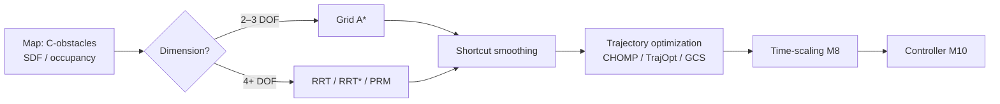

# M9 · Motion planning

Lynch & Park Ch 10 Used in: every collision-free reach, every row path, every flight plan Tracks: B, C, D

> **Hook:** A motion planner is a hiker's map app for robots: it is handed a map with lakes on it (C-obstacles), a trailhead and a summit, and it must draw a trail through the dry land — fast, short, and without walking into the water.

## Intuition first

**Hiking with a map around lakes.** You stand at a trailhead. The summit is across a valley full of lakes. You have three ways to plan:

1. **Lay graph paper over the map** and check square by square, always expanding the square that looks closest to the summit "as the crow flies". That is **A\***.
2. **Throw darts at the map.** Every dart that lands on dry land, connect it to your nearest known trail point if the straight walk is dry. Keep going until one branch reaches the summit. That is **RRT**. Keep throwing and re-routing branches through better junctions, and the trail keeps getting shorter: **RRT\***.
3. **Feel the slope.** Pretend the summit is a magnet and the lakes push you away, then just walk downhill on that "force field". That is a **potential field** — fast, but you can get stuck in a bay that faces the summit.

After you have *a* trail, you **straighten it** (cut corners where the shortcut is still dry) and **time it** (M8). One story thread runs through the page: the map is C-space (M1), the lakes are C-obstacles, and the trail is a curve \(q(s)\) through free space.

## Problem → math basic → move → result

1. **Problem.** Find a curve \(q:[0,1]\to\mathcal C_{\text{free}}\) with \(q(0)=q_{\text{start}}\), \(q(1)=q_{\text{goal}}\) — and ideally the shortest or smoothest one.
2. **Math basic.** \(\mathcal C_{\text{free}} = \mathcal C\setminus\mathcal C_{\text{obs}}\) has no closed form, but we can **test** one point or one short segment for collision cheaply.
3. **Move.** Replace the continuous problem by a **graph search** (grid or random samples) or by **optimization** of a discretized path with a collision penalty.
4. **Result.** Planners with known guarantees — complete, resolution-complete, or probabilistically complete — and known costs (cells, samples, iterations), plus optimizers that smooth the result.

## Part 1 — The planning problem in free C-space

From M1: a robot with configuration \(q\) collides when its body overlaps an obstacle. The forbidden set is

\[
\mathcal C_{\text{obs}} = \{\,q\in\mathcal C : \mathcal A(q)\cap\mathcal B\neq\emptyset\,\},\qquad \mathcal C_{\text{free}} = \mathcal C\setminus\mathcal C_{\text{obs}}
\]

where \(\mathcal A(q)\) is the space the robot occupies at \(q\) and \(\mathcal B\) is the obstacles.

**Simplest case that still teaches everything.** A disc robot of radius \(r\) that can only translate, among disc obstacles of radius \(\rho_i\) at \(c_i\). Then \(q=(x,y)\) and

\[
q\in\mathcal C_{\text{obs}} \iff \lVert q - c_i\rVert \le \rho_i + r \ \text{ for some } i
\]

*Why this move:* "robot touches obstacle" becomes "**point** touches **grown** obstacle". Shrink the robot to a point, inflate every obstacle by the robot radius — the **Minkowski sum**. The widget below draws these grown discs as dashed rings.

**Two tests every planner calls.**

| Test | Question | Cost here |
|---|---|---|
| `freePt(q)` | is one configuration free? | one distance per obstacle |
| `freeSeg(q_a, q_b)` | is the straight segment free? | point-to-segment distance per obstacle |

For an arm (M1's 2R arm) the same two tests exist, but `freePt` needs forward kinematics (M3) and a geometric collision check; that is where 90% of planning time goes. A **signed distance function** \(d(q)\) (positive outside, negative inside) makes both tests and their gradients cheap.

### How strong is the guarantee?

| Guarantee | Meaning | Example |
|---|---|---|
| **Complete** | finds a path if one exists, otherwise reports none, in finite time | exact cell decomposition, visibility graph (polygons in 2D) |
| **Resolution-complete** | complete *at the chosen grid size* \(h\); may miss passages narrower than \(\sim h\) | grid A\*, Dijkstra |
| **Probabilistically complete** | \(\Pr[\text{fail}]\to 0\) as samples \(N\to\infty\) | PRM, RRT, RRT\* |
| **None** | may fail even when a path exists | potential fields, local optimizers |

If the only gap is a small box of side \(\delta\) inside a unit C-space of dimension \(d\), a uniform sample lands in it with probability \(\delta^{d}\). With \(\delta=0.05\): \(0.25\%\) in 2D, but \(3\times10^{-7}\) for a 5-DOF arm. That number is why "narrow passages" are the classic failure of sampling planners.

## Part 2 — Grid search: Dijkstra and A\*

Lay a grid of spacing \(h\) over \(\mathcal C\). Each free cell is a graph node; neighbors (4 or 8 of them) are edges with cost = length of the step (\(h\) or \(\sqrt2\,h\)).

**Step 1 — cost-to-come.** Let \(g(n)\) = cost of the best path found so far from start to node \(n\). Dijkstra always expands the open node with smallest \(g\):

\[
g(m) \leftarrow \min\big(g(m),\ g(n) + c(n,m)\big)\quad\text{for each neighbor } m \text{ of } n
\]

*Why this move:* it is "relax the edges" — the discrete version of a wavefront spreading out from the start at unit speed.

**Step 2 — add a heuristic.** A\* expands the node with smallest

\[
f(n) = g(n) + h(n),\qquad h(n)=\text{estimated cost-to-go, e.g. } \lVert n - q_{\text{goal}}\rVert
\]

*Why this move:* Dijkstra spreads in a circle; A\* leans the wavefront toward the goal, so it expands far fewer cells.

**Step 3 — when is A\* still optimal?** If \(h\) never overestimates the true cost-to-go (it is **admissible**), A\* returns the shortest path on the graph. Straight-line distance is admissible because no path is shorter than a straight line.

\[
0\le h(n)\le h^\*(n)\ \ \forall n \quad\Longrightarrow\quad \text{A* is optimal}
\]

**Weighted A\*** uses \(f = g + w\,h\) with \(w>1\). It expands fewer cells but may return a path up to \(w\) times longer than optimal.

**The cost of grids.** Cells grow as \((L/h)^d\). For the 5-joint SO-ARM101 at \(h = 3^\circ\): \((360/3)^5 = 120^5 \approx 2.5\times10^{10}\) cells — before you add the gripper. Grids are perfect for 2–3 DOF (a rover's \((x,y,\phi)\)) and hopeless past ~5.

## Part 3 — Sampling: PRM, RRT, RRT\*

Sampling planners never build \(\mathcal C_{\text{free}}\). They only call `freePt` and `freeSeg` on random samples.

**PRM (probabilistic roadmap, multi-query).**

1. Sample \(N\) free configurations.
2. Connect each to its \(k\) nearest neighbors when `freeSeg` passes.
3. Answer any start–goal query by adding the two points and running A\* on this roadmap.

*Why this move:* build the road network once, query it many times — good for a static workcell (the turntable station, a fixed bench).

**RRT (rapidly-exploring random tree, single-query).** Grow one tree from the start:

1. Sample \(q_{\text{rand}}\) (with a small chance, sample the goal itself — "goal bias").
2. Find the nearest tree node \(q_{\text{near}}\).
3. Step toward it by at most \(\eta\): \(q_{\text{new}} = q_{\text{near}} + \min\!\big(1, \tfrac{\eta}{\lVert q_{\text{rand}}-q_{\text{near}}\rVert}\big)(q_{\text{rand}}-q_{\text{near}})\).
4. If `freeSeg(q_near, q_new)`, add the edge. Stop when \(q_{\text{new}}\) can see the goal.

*Why this move:* the nearest node to a random point is most likely on the **edge** of the tree facing big empty regions (its Voronoi cell is large). So the tree is pulled outward into unexplored space — "rapidly exploring".

**RRT is not optimal.** Its first path is jagged and it never gets better. Karaman & Frazzoli (2011) proved the RRT path cost converges to the optimum with probability **zero**.

**RRT\* fixes it with two extra steps** inside a shrinking ball of radius

\[
r_N = \min\!\left\{\gamma\left(\frac{\log N}{N}\right)^{1/d},\ \eta'\right\}
\]

- **Choose parent:** among nodes within \(r_N\), connect \(q_{\text{new}}\) to the one that minimizes \(\text{cost}(q_i) + \lVert q_i - q_{\text{new}}\rVert\).
- **Rewire:** for each neighbor \(q_i\), if going through \(q_{\text{new}}\) is cheaper, switch its parent to \(q_{\text{new}}\) and push the cost change down its subtree.

*Why this move:* this is Dijkstra's "relax the edges" (Part 2) applied locally on a random graph. The \((\log N/N)^{1/d}\) radius is just big enough that each new node has \(\sim\log N\) neighbors — enough to make the cost converge to optimal, with \(O(\log N)\) work per sample.

Try: with **RRT\*** move the **iterations** slider from 300 to 4000 and watch the convergence curve fall toward the green reference (fine-grid A\*). Switch to **RRT**: one jagged path, then it stops. Switch to **A\*** and raise the weight \(w\) to 3 — fewer cells, longer path. Pick **Potential field** and drag the start behind the big disc to find a local minimum.

??? question "What if we didn't seed the random number generator?"
    Every run would give a different tree, so you could not compare RRT and RRT\* fairly or reproduce a bug. Research benchmarks (e.g. OMPL's) report statistics over many seeds — median path length, success rate, time. Change the **seed** slider: the *first* RRT path changes a lot; the RRT\* path after 4000 iterations changes much less. That shrinking spread is what "asymptotically optimal" looks like in practice.

## Part 4 — Potential fields and local minima

Build an energy that is low at the goal and high near obstacles:

\[
U(q) = \underbrace{\tfrac12 k_{\text{att}}\lVert q - q_{\text{goal}}\rVert^2}_{\text{attractive}} + \sum_i \underbrace{\tfrac12 k_{\text{rep}}\left(\frac{1}{d_i(q)} - \frac{1}{d_0}\right)^2}_{\text{repulsive, only if } d_i(q) < d_0}
\]

where \(d_i(q)\) is the signed distance to obstacle \(i\). Then walk downhill:

\[
q_{k+1} = q_k - \alpha\,\nabla U(q_k)
\]

*Why this move:* it is gradient descent — one cheap step per control cycle, so it runs at 1 kHz as a **reactive** layer.

**The catch.** Where the obstacle's push exactly cancels the goal's pull, \(\nabla U = 0\) but \(q\neq q_{\text{goal}}\): a **local minimum**. In the widget, put the big disc straight between start and goal: the robot stops in front of it. Move the start slightly off the line and it slides around. A **navigation function** (Rimon–Koditschek) is a specially shaped \(U\) with only one minimum, but it is hard to build for general shapes.

??? warning "Potential fields are not planners"
    They have no guarantee at all (last row of the guarantee table). Use them as a **local** reactive layer under a global planner: A\* or RRT finds the route between rows, a potential field or a control-barrier function nudges the rover away from a leaning stalk in real time.

## Part 5 — Trajectory optimization and smoothing

Sampling gives a feasible but ugly path. **Optimization** improves it. Discretize the path into waypoints \(\xi = (q_1,\dots,q_K)\) and solve

\[
\min_{\xi}\ \underbrace{\sum_{k}\lVert q_{k+1} - 2q_k + q_{k-1}\rVert^2}_{\text{smoothness}} \;+\; \lambda\,\underbrace{\sum_k c_{\text{obs}}(q_k)}_{\text{collision cost from SDF}}
\]

- **CHOMP** (Ratliff et al., 2009): gradient descent on this cost, preconditioned by the smoothness matrix \(A\) (a second-difference, i.e. 1D discrete Laplacian), so updates spread smoothly along the path.
- **TrajOpt** (Schulman et al., 2013): sequential convex optimization; collisions become linearized **constraints** \(d(q_k)\ge d_{\text{safe}}\) with a trust region.

*Why this move:* the smoothness term is exactly the 1D finite-difference stiffness matrix. The optimizer is a small PDE-constrained problem: "find the stiffest-straight string that stays out of the obstacle field".

**Shortcut smoothing** (the checkbox in the widget) is the cheap version: pick two random waypoints; if the straight segment between them is free, delete everything in between. Repeat. Then hand the shortened path to M8 to add timing.

### The modern twists

- **GPU-parallel planning.** cuRobo runs many collision-free IK seeds and many trajectory optimizations in parallel on a GPU against signed-distance fields, reporting ~50 ms average motion generation (60× faster than prior trajectory optimizers) and ~20 ms for its geometric planner ([Sundaralingam et al., 2023](https://arxiv.org/abs/2310.17274)).
- **Graphs of Convex Sets (GCS).** Cover \(\mathcal C_{\text{free}}\) with convex regions, make them nodes of a graph, and solve "which regions + which smooth curve inside them" as one convex relaxation of a mixed-integer program. It combines A\*-style discrete choice with trajectory optimization ([Marcucci et al., *Science Robotics* 2023](https://groups.csail.mit.edu/robotics-center/public_papers/Marcucci24a.pdf); [MIT News](https://news.mit.edu/2023/new-optimization-framework-robot-motion-planning-1130)).

## Math bridges

| Here | DiffSim / FVEM | Genomics-Lab | 3D vision |
|---|---|---|---|
| Dijkstra/A\* wavefront \(g(m)=\min(g(n)+c)\) | discrete form of the eikonal equation \(\lVert\nabla T\rVert = 1\); fast-marching solves it on a mesh | — | geodesic distances on point-cloud graphs |
| Grown obstacles / signed distance \(d(q)\) | SDF of the boundary in the shifted boundary method | — | SDF / occupancy fields (NeuS, TSDF fusion) |
| Smoothness term \(\sum\lVert q_{k+1}-2q_k+q_{k-1}\rVert^2\) | 1D second-difference = FEM/FD stiffness (Laplacian) matrix | smoothing penalty in random-regression / spline models | trajectory smoothing of camera paths |
| Trajectory optimization with collision constraint | PDE-constrained optimization; adjoint gradients | — | bundle adjustment as constrained least squares |
| RRT/PRM random samples, \(\Pr[\text{fail}]\to0\) | Monte Carlo integration, error \(\sim N^{-1/2}\) | Monte Carlo / MCMC in Bayesian genomic models | RANSAC: random samples to find inliers |
| Admissible heuristic \(h\le h^\*\) | a-posteriori error *lower bound* | — | — |

## In your robots

| Where | What this module gives you |
|---|---|
| **Jetson Orin rover (RGB-only)** | Low-dimensional C-space \((x,y,\phi)\): grid A\* or lattice planners for headland turns and row switches; a reactive layer (potential field / barrier) for in-row stalks. Row-following itself is often learned (see research). |
| **Planned under-canopy drone** | 3D position C-space with tight gaps between rows and leaves: sampling or GPU trajectory optimization against an occupancy/SDF map, then minimum-snap time scaling (M8, Track B). |
| **Crazyflie + Flow deck** | Small indoor arena: a 3D grid A\* over a known obstacle map is cheap; waypoint lists are sent to the onboard position controller (M10). |
| **SO-ARM101** | 5-DOF C-space: grids are out (\(120^5\) cells); use RRT-Connect/RRT\* or cuRobo-style optimization. Reaching between leaves = narrow passages, so expect many samples. |
| **ComXim turntable station** | Static scene, repeated queries → build a PRM once; every scan pose reuses it. |
| **Maize/Soybean Plot Builder** | Synthetic plots give ground-truth geometry to build SDFs and benchmark planners (success rate, path length vs seed) before field trials. |

## Current research

- **GPU-parallel motion generation.** cuRobo solves collision-free IK and trajectory optimization in parallel on GPUs, ~50 ms per difficult problem ([arXiv 2310.17274](https://arxiv.org/abs/2310.17274); [curobo.org](https://curobo.org)).
- **Convex decompositions.** Graphs of Convex Sets turn planning around obstacles into a tight convex relaxation ([Marcucci et al.](https://groups.csail.mit.edu/robotics-center/public_papers/Marcucci24a.pdf)).
- **Learned planners.** Diffusion models trained on expert trajectories, guided by collision-cost gradients during denoising, generate diverse collision-free arm motions ([Motion Planning Diffusion, Carvalho et al.](https://arxiv.org/html/2308.01557v2)).
- **Under-canopy field navigation.** CropNav switches between LiDAR under-canopy row following and GNSS waypoints with collision recovery ([Gasparino et al.](https://arxiv.org/html/2411.10974v1)); LeCropFollow plans in a learned latent space from semantic heatmaps and transfers zero-shot from simulation to corn fields ([Tommaselli et al.](https://arxiv.org/pdf/2606.31941)); aerial-LiDAR maps plus D\* Lite replanning guide ground robots under forest canopy ([de Lima et al.](https://arxiv.org/abs/2404.03911v1)).
- **Reaching through foliage.** RICE balances pushing through soft leaves against avoiding stiff branches using tactile feedback ([Parayil et al.](https://arxiv.org/html/2506.10383v1)) — leaves treated as *permeable* rather than hard obstacles.

## Challenges

1. **Dimension.** A 120-cell-per-axis grid is \(1.4\times10^4\) cells in 2D but \(2.5\times10^{10}\) for a 5-DOF arm; sampling avoids the grid but still struggles with narrow passages (sample hit rate \(\sim\delta^d\)).
2. **Collision checking dominates time.** Most of a planner's compute is `freePt`/`freeSeg`; for dense leaf meshes this means millions of triangle tests unless you use an SDF or GPU.
3. **Plants are not rigid obstacles.** Leaves bend, so "collision" is really "contact with acceptable force" — the hard-obstacle model is too conservative and fails between rows.
4. **Moving and uncertain maps.** Wind-blown canopy and RGB-only depth error (often several cm) mean the C-obstacles shift; plans must be replanned at 5–20 Hz or made robust.
5. **Guarantees vs speed.** Optimizers (CHOMP/TrajOpt) are fast but local; sampling is complete in the limit but slow to converge to good paths.

## Next five years

- **Planner = GPU kernel.** Thousands of parallel samples/optimizations per control cycle, making replanning at sensor rate the default.
- **Learned priors + classical guarantees:** diffusion or VLA policies propose trajectories; a convex or sampling planner certifies or repairs them.
- **Contact-aware planning** where deformable obstacles (leaves, stalks) have a cost per newton instead of a hard wall.
- **Agriculture:** planners trained and benchmarked in procedural plot models (Maize/Soybean Plot Builder) for under-canopy flight and arm reaching to leaves for sensor clips and tissue sampling, then transferred to real rows.

## Check yourself

A* uses the straight-line distance to the goal as its heuristic. Why does it still return the shortest grid path?

<ol><li data-k="a">Because the grid is 8-connected</li><li data-k="b">Because the heuristic is exactly the true cost</li><li data-k="c">Because the heuristic never overestimates the true remaining cost</li><li data-k="d">Because A* expands every cell</li></ol>

What makes RRT* asymptotically optimal while RRT is not?

<ol><li data-k="a">Choosing the cheapest parent and rewiring neighbors within a shrinking radius</li><li data-k="b">A larger step size η</li><li data-k="c">Sampling the goal more often</li><li data-k="d">Using a grid instead of random samples</li></ol>

A potential-field robot stops in front of a wide obstacle directly between it and the goal. This is:

<ol><li data-k="a">a narrow passage</li><li data-k="b">a resolution problem of the grid</li><li data-k="c">a sign that the heuristic is inadmissible</li><li data-k="d">a local minimum where ∇U = 0</li></ol>

One line: planning is finding a dry trail through C-space around the lakes of C-obstacles — grids search it, random darts explore it, gradients polish it, and each comes with a different guarantee.

**Carries over to:** [M1](m01-configuration-space.md) (C-obstacles), [M8](m08-trajectory-generation.md) (time-scaling the path), [M10](m10-robot-control.md) (tracking the trajectory), [M12](m12-wheeled-mobile-robots.md) (planning with nonholonomic constraints), [Track B](t-b-aerial.md) (under-canopy flight), [Track D](t-d-physical-ai.md) (learned planners and policies).
