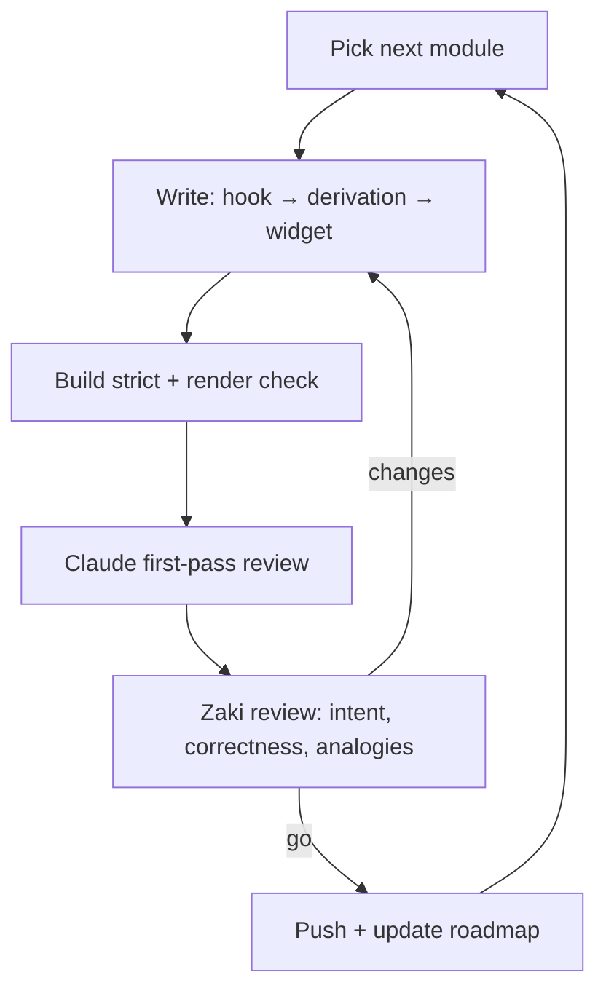

# Roadmap

The spine is Lynch & Park. Each book chapter becomes one module. After the book, four tracks connect the math to the hardware I own and the research I do.

## Part A — the book (manipulation core)

| Module | Book | Core idea in one line | Main math | Status |
|---|---|---|---|---|
| M1 | Ch 2 Configuration space | How many numbers pin down the robot? | DOF, Grübler, manifolds, constraints | ✅ written |
| M2 | Ch 3 Rigid-body motions | Rotations and poses as matrices you can multiply | \(\SO(3)\), \(\SE(3)\), exp/log, twists, screws | 🟡 review |
| M3 | Ch 4 Forward kinematics | Chain the poses: product of exponentials | PoE, DH comparison | ⬜ |
| M4 | Ch 5 Velocity kinematics & statics | Joint speeds → end-effector twist | Jacobian, singularities, manipulability ellipsoid | ⬜ |
| M5 | Ch 6 Inverse kinematics | Run the Jacobian backwards | Newton–Raphson, damped least squares (= ridge) | ⬜ |
| M6 | Ch 7 Closed chains | Loops add constraints | Constraint Jacobians, Lagrange multipliers | ⬜ |
| M7 | Ch 8 Dynamics of open chains | Force = mass × acceleration, for linkages | Lagrangian, Newton–Euler, mass matrix | ⬜ |
| M8 | Ch 9 Trajectory generation | Smooth paths in time | Polynomials, splines, time scaling | ⬜ |
| M9 | Ch 10 Motion planning | Find a path that doesn't hit anything | RRT, PRM, potential fields, optimization | ⬜ |
| M10 | Ch 11 Robot control | Make the error shrink | PID, computed torque, impedance | ⬜ |
| M11 | Ch 12 Grasping & manipulation | Fingers, friction and contact | Friction cones, form/force closure | ⬜ |
| M12 | Ch 13 Wheeled mobile robots | Robots that roll | Nonholonomic constraints, odometry | ⬜ |

## Part B–E — tracks beyond the book

| Track | Hardware | Modules planned | Bridges to |
|---|---|---|---|
| B · Aerial | Crazyflie (Flow + AI deck), under-canopy drone | Quadrotor dynamics on \(\SE(3)\), cascaded PID, geometric control, optical flow | CanopySense PAR mount, UAV/LiDAR maize |
| C · Ground rover | Jetson Orin rover, RGB-only nav | Kalman / EKF on Lie groups, visual odometry, SLAM, row following | Maize Plot Builder synthetic video, VGGT |
| D · Physical AI | SO-ARM101 + LeRobot | Imitation learning (ACT, diffusion policy), VLA models, sim2real, world models | Synthetic plant assets, digital twins |
| E · Estimation & learning glue | all | Least squares, Bayes filters, differentiable simulation, adjoints | DiffSim-Lab, FVEM Parts 5–6, Genomics-Lab |

## How we work through it

Each step ends at a **review checkpoint**: I do a first-pass review, then you do the domain review on the [review page](review/step1-review.md). Next step starts only after your "go".

