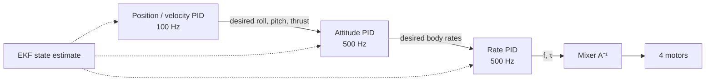

# B · Aerial robots

Track B Builds on: M2, M7, M10 Hardware: Crazyflie 2.x, under-canopy drone

> **Hook:** A quadrotor can only push straight "up" out of its own belly, so to fly sideways it must first tilt — exactly like balancing a broomstick on your hand by moving your hand under it.

## Intuition first

**The broomstick on your hand.** To move a balanced broom to the left, you can't just push it left. You first let it lean left, then chase it with your hand. The lean comes first; the travel follows. Your eyes watch the tip (fast job), your arm decides where the broom should go (slow job).

A quadrotor works the same way. Its four rotors all push along one direction — the body \(z\)-axis. To go sideways it **tilts** the thrust, and the sideways part of the thrust accelerates it. One story thread runs through the page:

1. **The broom is a rigid body** → pose \(T\in\SE(3)\), thrust along \(Re_3\) (M2).
2. **How it falls and spins** → Newton–Euler equations (M7).
3. **Only one push direction** → underactuation: 4 inputs, 6 DOF.
4. **Fast eyes, slow arm** → cascaded control: position → attitude → rate (M10), and a geometric version on \(\SO(3)\).
5. **Knowing where the hand is** → state estimation with the Flow deck and AI deck.

## Problem → math basic → move → result

1. **Problem.** A quadrotor has 6 DOF (3 position + 3 orientation) but only 4 motors. It can't push sideways directly.
2. **Math basic.** Total thrust \(f\) acts along \(Re_3\); motor speed differences make a body torque \(\tau\). Newton–Euler gives \(m\ddot p = -mge_3 + fRe_3\) and \(J\dot\omega + \omega\times J\omega = \tau\).
3. **Move.** Treat the thrust *direction* as a control signal: pick the acceleration you want, solve for the tilt \(R_d\) that points thrust that way, then let a fast attitude loop track \(R_d\).
4. **Result.** A cascaded (or geometric) controller that turns a position target into four motor thrusts — the same structure the Crazyflie firmware runs by default.

## Part 1 — The quadrotor as a rigid body

Pose \(T_{sb} = (R, p)\in\SE(3)\) as in M2. Body \(z\) points out of the top. Each rotor \(i\) makes thrust \(f_i\ge 0\) along body \(z\) and a drag torque \(\pm c_\tau f_i\) about it (sign set by spin direction).

**Translation (Newton, in {s}):**

\[
m\ddot p = -mg\,e_3 + f\,R\,e_3,\qquad f = \textstyle\sum_{i=1}^4 f_i
\]

*Why \(Re_3\):* thrust is fixed in the body as \((0,0,f)\). M2 says \(p_s = R\,p_b\), so in space it is \(R\,(0,0,f)^\top = f\,Re_3\) — the third column of \(R\).

**Rotation (Euler, in {b}):**

\[
J\dot\omega_b + \omega_b\times J\omega_b = \tau_b
\]

*Why body frame:* in {b} the inertia \(J\) is a constant matrix. In {s} it would change every time the drone turns. This is the 6×6 Newton–Euler equation of M7, \(\mathcal F_b = \mathcal G_b\dot{\mathcal V}_b - [\mathrm{ad}_{\mathcal V_b}]^\top\mathcal G_b\mathcal V_b\), for one free body.

??? warning "Units check with example values"
    A Crazyflie-sized drone (example values): \(m \approx 0.033\) kg, so hover needs \(f = mg \approx 0.32\) N, about 0.08 N per motor. Inertia is tiny (\(J_{xx}\sim 10^{-5}\) kg·m²), which is why it spins fast and needs a fast inner loop.

### The mixer: 4 thrusts → (f, τ)

For an "X" layout with arm length \(l\) (rotor at \(45^\circ\) from the axes, so the lever is \(d = l/\sqrt2\)):

\[
\begin{bmatrix} f\\ \tau_x\\ \tau_y\\ \tau_z\end{bmatrix} =
\underbrace{\begin{bmatrix} 1 & 1 & 1 & 1\\ -d & -d & d & d\\ -d & d & d & -d\\ -c_\tau & c_\tau & -c_\tau & c_\tau\end{bmatrix}}_{A}
\begin{bmatrix} f_1\\ f_2\\ f_3\\ f_4\end{bmatrix}
\]

(Signs depend on motor numbering — check your firmware.) \(A\) is square and invertible, so the controller computes \((f,\tau)\) and the **mixer** applies \(A^{-1}\).

*Why this move:* it hides the motors. Above the mixer the drone is "one thrust + one torque vector" — 4 numbers.

??? question "What if the mixer asks for a negative thrust?"
    Fixed-pitch rotors can only push, \(0\le f_i\le f_{\max}\). If \(A^{-1}\) returns a value outside that box, the motor **saturates** and the torque you get is not the torque you asked for. Real firmware clips or prioritises attitude over thrust. The widget below shows saturation in red.

## Part 2 — Underactuation and differential flatness

Count: 6 DOF, 4 inputs. Rotation is fully actuated (3 torques for 3 angles). Translation has **one** actuated direction, \(Re_3\). Sideways acceleration only happens through tilt — the broom must lean before it travels.

**Flatness.** Mellinger and Kumar (2011) showed that if you choose the four "flat outputs" \(\sigma = (x, y, z, \psi)\) (position and yaw) as smooth curves, every state and input follows by differentiation:

\[
f\,Re_3 = m(\ddot p + g e_3)\;\Rightarrow\; f = m\lVert\ddot p + ge_3\rVert,\qquad z_b = \frac{\ddot p + ge_3}{\lVert\ddot p + ge_3\rVert}
\]

*Why this move:* the thrust direction \(z_b\) is fixed by the acceleration you want. Yaw \(\psi\) then fixes the other two body axes, so \(R\) is known. One more derivative (jerk) gives \(\omega\); one more (snap) gives \(\tau\). That is why drone trajectories are planned as **minimum-snap** polynomials (M8).

## Part 3 — Cascaded control (the Crazyflie default)

Fast eyes, slow arm. Each loop's output is the next loop's setpoint:

The rates above are from the [Bitcraze controller docs](https://bitcraze.io/documentation/repository/crazyflie-firmware/master/functional-areas/sensor-to-control/controllers/), which list cascaded PID as the default and also Mellinger, INDI, Brescianini and Lee controllers.

**Planar version** (the widget). State \((y, z, \phi)\), two rotor thrusts \(f_1, f_2\) at \(\pm l\):

\[
m\ddot y = -(f_1+f_2)\sin\phi,\qquad m\ddot z = (f_1+f_2)\cos\phi - mg,\qquad I\ddot\phi = l\,(f_2 - f_1)
\]

Outer loop: \(a_d = K_p(p_d - p) - K_d\dot p\). Thrust direction: \(\phi_d = -\operatorname{atan2}(a_{d,y},\, g + a_{d,z})\). Inner loop: \(\tau = I\,[K_{p,\phi}(\phi_d-\phi) - K_{d,\phi}\dot\phi]\).

*Why this move:* if the inner loop is **much faster** (rule of thumb: 5–10× the bandwidth), the outer loop can pretend tilt is instant — time-scale separation, the broom-balancer's fast eyes.

Try: click a target to the right and watch the drone tilt *first*, then translate (the dashed φ-desired line moves before y). Then drop "Kp attitude" to ~20 so the inner loop is slower than the outer one — it falls. Raise "Kp position" to 20 with max tilt 60° and watch the thrust arrows turn red (saturation).

## Part 4 — Geometric control on SO(3)

PID on roll/pitch/yaw angles inherits Euler-angle problems (M2's gimbal lock) and fails at large tilts. Lee, Leok and McClamroch (2010) wrote the attitude error directly on \(\SO(3)\):

\[
e_R = \tfrac12\left(R_d^\top R - R^\top R_d\right)^\vee,\qquad e_\omega = \omega - R^\top R_d\,\omega_d
\]

\[
\tau = -k_R e_R - k_\omega e_\omega + \omega\times J\omega - J\left([\omega]R^\top R_d\omega_d - R^\top R_d\dot\omega_d\right)
\]

*Why this form of \(e_R\):* let \(R_d^\top R = e^{[\hat\omega]\theta}\) be the error rotation. By Rodrigues (M2), its skew part is \(\tfrac12(X - X^\top) = \sin\theta\,[\hat\omega]\). So \(e_R = \sin\theta\,\hat\omega\): the M2 **log map**, with \(\theta\) swapped for \(\sin\theta\). Small errors: \(e_R\approx\hat\omega\theta\). It needs no angle chart, so it works for almost all orientations (it is almost-globally stable; \(\theta=180^\circ\) is the single bad spot, same as the M2 log).

The position loop picks the thrust direction \(z_{b,d}\) from the desired acceleration (Part 2) and the thrust \(f = (m(\ddot p_d + ge_3) + \ldots)\cdot Re_3\) — project the wanted force onto the axis you actually have.

## Part 5 — Knowing where you are: Flow deck and AI deck

Control is only as good as the state estimate. The Crazyflie fuses sensors in an **extended Kalman filter** (Track C derives it).

| Sensor | Measures | Model the EKF uses |
|---|---|---|
| IMU (gyro, accel) | \(\omega_b\), specific force | prediction step |
| Flow deck v2: VL53L1x time-of-flight | height \(h\) to the ground (up to 4 m) | \(h = p_z/\cos(\text{tilt})\) |
| Flow deck v2: PMW3901 optical flow | pixel motion of the ground | flow \(\approx \frac{v_{xy}}{h} - \omega\) (tilt-rate compensated) |
| AI deck 1.1 | 320×320 grayscale camera (Himax HM01B0) + GAP8 RISC-V processor | on-board CNN, or stream to a PC |

Sensor names are from Bitcraze's [Flow deck v2](https://www.bitcraze.io/products/flow-deck-v2/) and [AI deck 1.1](https://store.bitcraze.io/products/ai-deck-1-1) pages.

*Why flow needs height:* optical flow measures angle per second. A ground patch moving at speed \(v\) seen from height \(h\) sweeps \(v/h\) rad/s. Without \(h\), fast-and-high looks the same as slow-and-low — the **scale ambiguity** of monocular SfM. The ToF sensor fixes the scale, the way a known baseline fixes scale in COLMAP.

??? warning "Optical flow over plants"
    The flow sensor assumes a flat, textured ground. Over a canopy, "ground" is leaves at many heights, moving in the wind and in the drone's own downwash. Expect biased velocity estimates and ToF readings that jump between leaf and soil.

## Part 6 — Flying under the canopy

Under maize or soybean rows the problem changes:

- **GPS-denied.** Leaves block and reflect satellite signals (multipath). Position must come from vision, flow, ToF or LiDAR plus the EKF.
- **Clutter.** Row gaps are often under 1 m. Small drones (Crazyflie, ~10 cm across) fit; large ones don't.
- **Downwash.** Rotor wash pushes leaves, which move into the propellers, change the flow-sensor view and change PAR readings.
- **Sensor mounting.** A PAR/light sensor on top of the drone is shaded by the frame and sees rotor-blade flicker; mounting it on a mast or reading during brief hover is a common compromise. Shadow of the drone itself biases downward-looking sensors.

## Math bridges

| Here | DiffSim / FVEM | Genomics-Lab | 3D vision |
|---|---|---|---|
| \(J\dot\omega + \omega\times J\omega = \tau\) | rigid-body ODE, explicit RK4 time stepping (as in the widget) | — | IMU propagation between camera frames |
| Mixer \(A^{-1}\) maps \((f,\tau)\) to \(f_i\) | assembling/solving a small linear system \(Ku=f\) | design matrix \(X\) maps effects to phenotypes | — |
| \(e_R = \tfrac12(R_d^\top R - R^\top R_d)^\vee\) | — | — | rotation error in pose-graph and BA residuals (M2 log map) |
| Flow \(\approx v/h - \omega\), scale fixed by ToF | — | — | monocular SfM scale ambiguity; NeRF needs metric camera poses |
| Inner loop ≫ outer loop | operator splitting / multirate time stepping | — | — |

## In your robots

| Where | What this track gives you |
|---|---|
| **Crazyflie 2.x** | Default stack is the 3-level cascade above with an EKF. Switch controllers via the `stabilizer.controller` parameter to compare PID vs Mellinger vs Lee on the same trajectory. |
| **Crazyflie + Flow deck** | Indoor hover without external tracking; scale from ToF. Test over a soybean tray to see the flow bias. |
| **Crazyflie + AI deck** | Run a small CNN on GAP8 for row/gap detection, or stream images to a PC for SfM / NeRF of a potted plant. |
| **Under-canopy drone (planned)** | Same equations, larger \(m, J\). Mixer and tilt limits decide how tight a row gap you can fly. Downwash and PAR mounting are design choices, not afterthoughts. |
| **Maize/Soybean Plot Builder** | Simulate a flight path between rows to get camera poses \(T_k\) for synthetic NeRF/3DGS training data. |

## Current research

- **Under-canopy autonomy without GNSS.** A lightweight camera-based drone flew autonomously below a boreal forest canopy and estimated tree diameter with about 3–4 cm error ([Karjalainen et al., 2025](https://arxiv.org/abs/2501.12073v3)); earlier large-scale under-canopy semantic SLAM flights came from UPenn ([Liu et al.](https://arxiv.org/pdf/2109.06479)).
- **Nano-drones for agriculture.** A Crazyflie 2.1 with a GAP9 shield and 8×8 ToF runs a pest detector at 6.8 fps on 33 mW, in a simulated 25-drone vineyard survey ([Crupi et al., 2025](https://arxiv.org/pdf/2502.14455)). A survey of nano-scale navigation covers the compute and sensing limits ([arXiv 2601.13252](https://arxiv.org/pdf/2601.13252)).
- **Controllers on tiny drones.** Mellinger's trajectory-tracking controller and its analysis on the Crazyflie ([Luis & Le Ny, 2016](https://arxiv.org/pdf/1608.05786)); the Crazyflie firmware now ships PID, Mellinger, INDI, Brescianini and Lee options ([Bitcraze docs](https://bitcraze.io/documentation/repository/crazyflie-firmware/master/functional-areas/sensor-to-control/controllers/)).
- **Geometric control** on \(\SE(3)\) (Lee, Leok & McClamroch, 2010) and **minimum-snap flatness** planning (Mellinger & Kumar, 2011) remain the reference designs that learned controllers are compared to.

## Challenges

1. **Saturation.** A nano-drone's thrust margin above hover is small, and each payload deck shrinks it; aggressive tilts quickly leave the mixer's feasible box (in the widget, thrust-to-weight is 1.85, so beyond cos φ = 1/1.85, about 57° of tilt, it cannot hold altitude).
2. **Payload vs flight time.** Each added deck (flow, AI, PAR sensor) cuts minutes of flight on a small battery.
3. **Flow over leaves.** Moving, multi-height canopy breaks the flat-ground model of the flow sensor; ToF jumps between leaf and soil.
4. **Downwash–plant interaction.** Wash deforms leaves near the drone, changing both the scene being imaged and the light being measured.
5. **On-board compute.** GAP8-class chips run tiny CNNs at a few fps; full SLAM must run off-board or on a larger drone.

## Next five years

- **Learned + geometric control:** neural residuals on top of \(\SO(3)\) controllers for gusts and payloads, keeping stability proofs.
- **Swarms of nano-drones** for cheap, distributed scouting inside fields, with relative localization instead of GPS.
- **On-board 3D mapping** (lightweight 3DGS/VGGT-style models) on next-generation low-power chips.
- **Phenotyping:** under-canopy drones measuring stalk diameter, ear height and PAR profiles in maize rows — traits that over-canopy UAVs can't see.

## Check yourself

In the space frame, total rotor thrust points along:

<ol><li data-k="a">e₃ always</li><li data-k="b">the first column of R</li><li data-k="c">the third column of R</li><li data-k="d">the velocity direction</li></ol>

In a cascaded controller, the attitude loop should be:

<ol><li data-k="a">much faster than the position loop</li><li data-k="b">slower than the position loop</li><li data-k="c">the same speed as the position loop</li><li data-k="d">turned off during hover</li></ol>

Why does the Flow deck carry a time-of-flight sensor next to the optical-flow sensor?

<ol><li data-k="a">to detect obstacles ahead</li><li data-k="b">to measure yaw</li><li data-k="c">to light up the ground</li><li data-k="d">to turn pixel motion into metres per second</li></ol>

One line: a quadrotor is a broomstick that can only push along its own axis — so it tilts first and travels second, with a fast attitude loop on SO(3) inside a slow position loop.

**Carries over to:** [M2](m02-rigid-body-motions.md) (\(Re_3\), log map), [M7](m07-dynamics.md) (Newton–Euler), [M8](m08-trajectory-generation.md) (minimum-snap), [M10](m10-robot-control.md) (PID, cascades), [Track C](t-c-rover-estimation.md) (EKF), [Track D](t-d-physical-ai.md) (learned policies).
