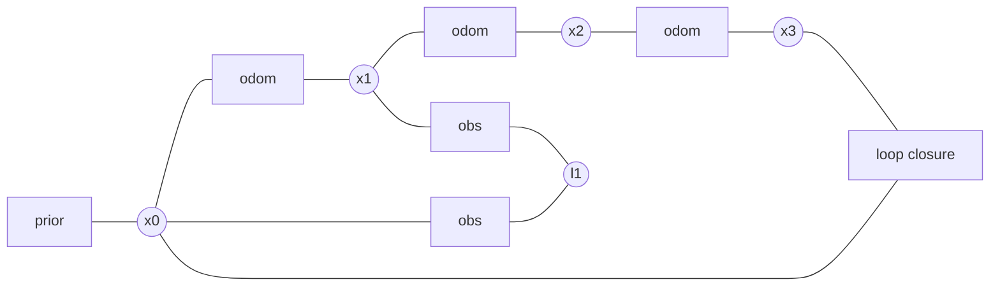

# C · Rover: estimation & SLAM

Track C Builds on: M2, M12 Hardware: Jetson Orin Nano rover, Crazyflie EKF

> **Hook:** A rover that only counts wheel turns is like you walking through a dark house counting steps — fine for a while, then lost — until you touch a doorframe you know and snap back to the truth.

## Intuition first

**Walking in a dark house.** You know your start point. Each step you guess where you are: "ten steps forward, turn left." Every step adds a little doubt, and the doubt grows — your mental "I'm somewhere in here" blob gets wider. Then your hand hits a doorframe you know. The blob shrinks at once. If you trust your steps a lot, you only nudge your guess; if you trust the doorframe a lot, you jump to it.

That is the whole page:

1. **Counting steps** → prediction with wheel odometry (M12 kinematics).
2. **The growing blob** → a covariance matrix \(P\), drawn as an ellipse.
3. **Touching the doorframe** → a measurement update (GPS fix, landmark).
4. **How much to trust each** → the Kalman gain \(K\).
5. **Remembering every doorframe and redrawing the whole walk** → SLAM as a factor graph (= bundle adjustment).

## Problem → math basic → move → result

1. **Problem.** Integrating noisy wheel speeds drifts without bound; GPS is noisy, slow, and blocked under the canopy.
2. **Math basic.** Represent belief as a Gaussian \(\mathcal N(\hat x, P)\). Linear maps of Gaussians stay Gaussian; conditioning a joint Gaussian on an observation has a closed form.
3. **Move.** Alternate predict (push mean and covariance through the motion model) and update (condition on the measurement). For nonlinear models, linearize with Jacobians (EKF). For a whole trajectory, solve one big nonlinear least-squares problem (SLAM).
4. **Result.** An estimate plus an honest error bar — the same formula as BLUP in genomic prediction and the same solver as bundle adjustment in COLMAP.

## Part 1 — The Bayes filter

State \(x_k\), control \(u_k\), measurement \(z_k\). Belief \(\mathrm{bel}(x_k) = p(x_k\mid z_{1:k}, u_{1:k})\).

\[
\overline{\mathrm{bel}}(x_k) = \int p(x_k\mid x_{k-1}, u_k)\,\mathrm{bel}(x_{k-1})\,dx_{k-1}\qquad\text{(predict: count a step)}
\]

\[
\mathrm{bel}(x_k) = \eta\; p(z_k\mid x_k)\;\overline{\mathrm{bel}}(x_k)\qquad\text{(update: touch the doorframe)}
\]

*Why this move:* the first line is the law of total probability (blur the belief by the motion noise); the second is Bayes' rule (\(\eta\) normalizes). Every filter below is this pair with a specific belief shape.

## Part 2 — Kalman filter, derived in 1D then in matrix form

**1D.** Prior \(x\sim\mathcal N(\hat x^-, p^-)\). Measurement \(z = x + n\), \(n\sim\mathcal N(0, r)\). Multiply the two Gaussians (Bayes) and complete the square:

\[
\hat x^+ = \frac{r\,\hat x^- + p^-\,z}{p^- + r} = \hat x^- + \underbrace{\frac{p^-}{p^-+r}}_{k}\,(z - \hat x^-),\qquad p^+ = (1-k)\,p^-
\]

*Why this form:* it is a weighted average, weights = inverse variances. \(k\in[0,1]\): trust the doorframe (\(r\to0\Rightarrow k\to1\)) or trust your steps (\(p^-\to0\Rightarrow k\to0\)). Numbers: \(p^- = 4\), \(r = 1\) gives \(k = 0.8\) and \(p^+ = 0.8\) — one measurement cut the variance five-fold.

**Matrix form.** Model \(x_k = Fx_{k-1} + Gu_k + w\), \(w\sim\mathcal N(0,Q)\); \(z_k = Hx_k + v\), \(v\sim\mathcal N(0,R)\).

\[
\text{Predict:}\quad \hat x^- = F\hat x + Gu,\qquad P^- = FPF^\top + Q
\]

\[
\text{Update:}\quad S = HP^-H^\top + R,\qquad K = P^-H^\top S^{-1},\qquad \hat x^+ = \hat x^- + K(z - H\hat x^-),\qquad P^+ = (I-KH)P^-
\]

*Why \(FPF^\top\):* if \(x\) has covariance \(P\), then \(Fx\) has covariance \(FPF^\top\) — the "how a blob stretches under a linear map" rule. Same rule makes \(JJ^\top\) the manipulability ellipse in M4.

??? question "What if we just averaged odometry and GPS 50/50?"
    A fixed 50/50 blend ignores that odometry is excellent over 1 s and terrible over 60 s, while GPS is the opposite. The Kalman gain changes every step: right after a fix \(P\) is small and \(K\) is small; after a long gap \(P\) has grown and the next fix gets a large \(K\). It is the **minimum-variance** linear blend, not a hand-tuned one.

## Part 3 — EKF for a unicycle rover

State \(x = (x, y, \phi)\) on \(\SE(2)\). Odometry gives measured speed \(v\) and turn rate \(\omega\) (M12). Midpoint motion model over \(\Delta t\), with \(h = \phi + \omega\Delta t/2\):

\[
f(x,u) = \begin{bmatrix} x + v\Delta t\cos h\\ y + v\Delta t\sin h\\ \phi + \omega\Delta t\end{bmatrix},\qquad
F = \frac{\partial f}{\partial x} = \begin{bmatrix} 1 & 0 & -v\Delta t\sin h\\ 0 & 1 & v\Delta t\cos h\\ 0 & 0 & 1\end{bmatrix}
\]

Noise enters through the inputs, so \(Q \to G\,\mathrm{diag}(\sigma_v^2, \sigma_\omega^2)\,G^\top\) with \(G = \partial f/\partial u\).

*Why the \(-v\Delta t\sin h\) term matters:* it couples heading error into position error. A 1° heading error after 10 m of driving is \(10\sin 1^\circ \approx 0.17\) m sideways — and it keeps growing. That is why the ellipses stretch **across** the direction of travel.

**Measurements.**

- *GPS:* \(z = (x, y) + v\), \(H = \begin{bmatrix}1&0&0\\0&1&0\end{bmatrix}\) — linear.
- *Landmark* at known \((l_x, l_y)\): range and bearing

\[
h(x) = \begin{bmatrix}\sqrt{q}\\ \operatorname{atan2}(\delta_y,\delta_x) - \phi\end{bmatrix},\quad
H = \begin{bmatrix} -\delta_x/\sqrt q & -\delta_y/\sqrt q & 0\\ \delta_y/q & -\delta_x/q & -1\end{bmatrix},\quad \delta = l - p,\ q = \lVert\delta\rVert^2
\]

*Why landmarks beat GPS here:* the bearing row has a \(-1\) in the \(\phi\) column, so a landmark fix corrects **heading** directly. GPS only sees position; heading gets fixed indirectly through the cross-covariance \(P_{x\phi}\).

**95% ellipse.** For the \(2\times2\) position block of \(P\) with eigenvalues \(\lambda_{1,2}\), the 95% region has semi-axes \(\sqrt{5.991\,\lambda_i}\) (5.991 = \(\chi^2_2\) at 0.95) along the eigenvectors.

Try: pick "No fixes" and watch the red dead-reckoning loop fail to close while the ellipses balloon. Switch to GPS and slide "fix every" from 2 s to 20 s — the error plot becomes a saw-tooth. Then choose "Landmark range + bearing": RMSE drops further because bearings fix heading. Mean NIS near 2 means the filter's ellipses are honest.

??? warning "The EKF can lie about its confidence"
    Linearizing at a wrong estimate gives a wrong \(H\), and \(P\) can shrink faster than the real error (inconsistency). Signs: NIS well above its expected value (2 for a 2-D measurement). Fixes: inflate \(Q\), iterate the update (IEKF), or use an error-state / invariant EKF on the Lie group.

## Part 4 — Uncertainty on SE(2) and Lie groups

Adding noise to \(\phi\) and wrapping angles works in 2D, but in 3D you can't add a covariance to a rotation matrix (M2: the sum leaves \(\SO(3)\)). Instead perturb in the Lie algebra:

\[
T = \exp([\xi])\,\hat T,\qquad \xi\sim\mathcal N(0, \Sigma),\ \xi\in\R^6\ (\text{or }\R^3\text{ for }\SE(2))
\]

*Why this move:* \(\xi\) lives in a flat vector space where Gaussians make sense, and \(\exp\) maps it onto the curved group. Changing frame uses the adjoint: \(\Sigma' = \Ad_T\Sigma\Ad_T^\top\) — the same \(FPF^\top\) rule. Long odometry drives produce the curved "banana" uncertainty that a straight ellipse in \((x,y)\) can't represent; it **is** a straight ellipse in \(\xi\).

## Part 5 — Visual odometry and RGB-only row following

Without GPS under the canopy, the camera becomes the odometer:

1. Detect and match features between frames (or predict dense flow).
2. Estimate relative pose \(T_{k,k+1}\) from the essential matrix (monocular: up to scale) or PnP against triangulated points.
3. Chain: \(T_k = T_{k-1}T_{k-1,k}\) — same drift as wheel odometry, often smaller.

For **row following** you often don't need a full pose. Predict the row's heading error \(\Delta\phi\) and lateral offset \(d\) from one image (keypoints or segmentation), then steer with a simple controller on \((d, \Delta\phi)\). That is what learned under-canopy systems do (see Current research). An EKF still helps: fuse the image's \((d,\Delta\phi)\) as a measurement with wheel odometry for smooth steering through gaps and occlusions.

## Part 6 — SLAM as a factor graph (= bundle adjustment)

The EKF forgets the past. SLAM keeps it: unknowns are all poses \(x_{0:N}\) and landmarks \(l_j\); each measurement is a **factor** (a residual with a covariance):

\[
\min_{x, l}\ \sum_k \lVert x_{k} \ominus f(x_{k-1},u_k)\rVert^2_{Q^{-1}} + \sum_{k,j}\lVert z_{kj} - h(x_k, l_j)\rVert^2_{R^{-1}}
\]

*Why this move:* Gauss–Newton linearizes every residual, giving normal equations \(J^\top\Sigma^{-1}J\,\delta = -J^\top\Sigma^{-1}r\). The matrix is sparse (each factor touches 1–2 variables), so it solves fast. **This is bundle adjustment**: COLMAP minimizes reprojection residuals over camera poses and 3D points with exactly this machinery (Levenberg–Marquardt = damped Gauss–Newton, M5).

**Loop closure.** When the rover recognizes a place it has seen (same row end, same landmark), one factor links \(x_N\) to \(x_0\). The optimizer spreads the accumulated drift over the whole loop — the dark-house walker remembering the front door and redrawing their mental map.

## Math bridges

| Here | DiffSim / FVEM | Genomics-Lab | 3D vision |
|---|---|---|---|
| \(K = P^-H^\top(HP^-H^\top + R)^{-1}\) | data assimilation (EnKF) in crop models, e.g. APSIM | **BLUP**: \(\hat u = GZ^\top(ZGZ^\top + \sigma_e^2 I)^{-1}(y - X\hat\beta)\) — same Gaussian conditioning with \(P^-\to G\), \(H\to Z\), \(R\to\sigma_e^2I\) | visual-inertial odometry |
| \(P^- = FPF^\top + Q\) | propagating uncertainty through a linear time step | covariance of a linear combination of breeding values | — |
| Factor graph, Gauss–Newton on \(J^\top\Sigma^{-1}J\) | sparse FE assembly: each element couples few nodes | mixed-model equations (Henderson) | **bundle adjustment** in COLMAP; 3DGS SLAM |
| Perturb on the group \(\exp([\xi])\hat T\) | — | — | pose refinement in NeRF/3DGS (M2) |
| NIS consistency check | residual-based error estimators | cross-validation of predictive accuracy | reprojection-error histograms |

!!! tip "Same formula, three names"
    Kalman update, BLUP and Gaussian-process regression all compute \(\mathbb E[x\mid z] = \mu_x + \Sigma_{xz}\Sigma_{zz}^{-1}(z - \mu_z)\). In GBLUP, \(\Sigma_{xz} = G Z^\top\) (kinship × incidence) and \(\Sigma_{zz} = ZGZ^\top + \sigma_e^2 I\). In the EKF, \(\Sigma_{xz} = P^-H^\top\) and \(\Sigma_{zz} = S\).

## In your robots

| Where | What this track gives you |
|---|---|
| **Jetson Orin Nano rover (RGB-only)** | EKF fusing wheel odometry + IMU yaw rate + image-based row offset \((d, \Delta\phi)\). Row ends and stakes act as landmarks; GPS only at headlands. |
| **Crazyflie** | The firmware EKF (Track B) fuses IMU with Flow-deck flow and ToF height — the same predict/update, 3D, on a microcontroller. |
| **ComXim turntable scanner** | Camera poses from one known screw axis are a perfect "prior factor"; BA then refines only small corrections. |
| **Maize/Soybean Plot Builder** | Ground-truth trajectories for synthetic rover video: measure VO drift and EKF RMSE where the truth is known exactly. |
| **APSIM / crop models** | Same update to assimilate LAI or soil moisture from drones/satellites into a crop simulation. |

## Current research

- **Learned under-canopy row following.** CropFollow++ uses keypoints from low-cost RGB cameras and logged about 25 km of autonomy with on average 767 m between interventions ([Sivakumar et al., 2024](https://arxiv.org/html/2404.17718v1)); CA-Cut augmentation cuts keypoint error by up to 36.9% on a cornfield dataset ([Mamo & Choi, 2025](https://arxiv.org/abs/2507.17727v2)). CropNav switches between RTK-GNSS waypoints and LiDAR row following ([Gasparino et al.](https://arxiv.org/html/2411.10974v1)).
- **Factor-graph SLAM in orchards.** Tree-SLAM fuses noisy GPS, odometry and trunk detections in a factor graph, with geo-localization errors as low as 18 cm ([Rapado-Rincon & Kootstra, 2025](https://web3.arxiv.org/pdf/2507.12093)).
- **Gaussian-splatting SLAM in agriculture.** AgriGS-SLAM combines LiDAR odometry, loop closure and multi-view 3DGS to map orchards across dormant, flowering and harvest seasons ([Usuelli et al., 2025](https://arxiv.org/abs/2510.26358v1)).
- **Data assimilation in crop models.** An EnKF assimilating LAI, biomass and soil moisture into APSIM-Wheat reduced a −38% yield underestimate to −8% with remotely sensed LAI ([Zhang et al., 2022](https://cris.bgu.ac.il/en/publications/assimilation-of-wheat-and-soil-states-into-the-apsim-wheat-crop-m-2/)).

## Challenges

1. **Perceptual aliasing.** Every maize row looks the same; false loop closures can bend a whole map. Robust kernels and place-recognition checks are needed.
2. **GNSS under the canopy.** Multipath makes even RTK unreliable once leaves close over the row; fixes become rare and biased.
3. **Wheel slip in mud.** Odometry noise is not Gaussian or stationary — slip can be meters, breaking \(Q\).
4. **Seasonal change.** The same field looks different every week; maps from V6 don't match R2 imagery.
5. **Compute on the edge.** Full factor-graph SLAM plus a vision network must share one Jetson-class GPU at real-time rates.

## Next five years

- **Foundation-model odometry**: VGGT-style networks predicting poses directly from video, fused as factors with wheel odometry.
- **Invariant / Lie-group filters** becoming the default over plain EKFs for consistent uncertainty.
- **Semantic SLAM** where landmarks are plants (stalks, trunks), so the map *is* the phenotyping dataset.
- **Phenotyping:** rovers building row-level 3DGS maps across the season and assimilating the traits into crop models (APSIM) in a single estimation loop.

## Check yourself

1D Kalman: prior variance 4, measurement variance 1. The gain k is:

<ol><li data-k="a">0.2</li><li data-k="b">0.8</li><li data-k="c">0.25</li><li data-k="d">4</li></ol>

Why does a landmark range-bearing fix usually beat a GPS fix of the same position accuracy?

<ol><li data-k="a">it is linear</li><li data-k="b">it has no noise</li><li data-k="c">it updates faster</li><li data-k="d">the bearing directly corrects heading</li></ol>

SLAM as a factor graph is mathematically the same as:

<ol><li data-k="a">bundle adjustment in COLMAP</li><li data-k="b">a PID controller</li><li data-k="c">Rodrigues' formula</li><li data-k="d">the mixer matrix of a quadrotor</li></ol>

One line: count steps and let your doubt grow, touch a known doorframe and shrink it — the Kalman gain decides how far to jump, and SLAM redraws the whole walk when you recognize the front door.

**Carries over to:** [M2](m02-rigid-body-motions.md) (Lie-group perturbations), [M5](m05-inverse-kinematics.md) (damped least squares = LM), [M12](m12-wheeled-mobile-robots.md) (unicycle kinematics), [Track B](t-b-aerial.md) (Crazyflie EKF), [Track E](t-e-learning-glue.md) (differentiable filters).
