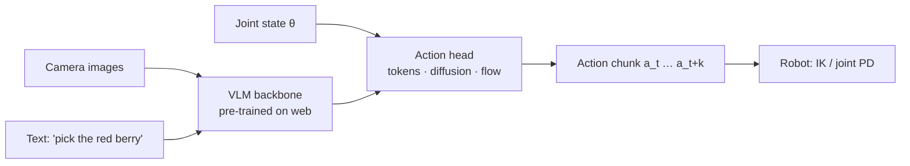

# D · Physical AI

Track D Builds on: M3–M10 Hardware: SO-ARM101 + LeRobot

> **Hook:** A robot policy learns a skill the way you learn a recipe by watching a cook — copy what they do in each moment — and it fails the same way: one small slip puts you in a kitchen state the cook never showed you.

## Intuition first

**Learning to cook by watching.** You watch a chef make an omelette ten times. You write down "when the pan looks like *this*, do *that*." This is **behavior cloning**: copy the action the expert took in each situation.

The story has four turns, and each is one part of this page:

1. **Copying moments** → a policy \(\pi(a\mid o)\) learned by regression (Part 1).
2. **The slip** → you crack the egg a bit off; now the pan looks like nothing you saw. Each slip makes the next one more likely: **compounding error** (Part 2). Fixes: memorize whole moves, not single moments (**action chunking**), or have the chef stand beside you and correct you in *your* mistakes (**DAgger**).
3. **Many good ways** → one chef flips left, another right. Averaging them flips straight into the wall. **Diffusion / flow policies** keep all good options (Part 3).
4. **A cookbook for every kitchen** → read the internet's cookbooks, then practise on many robots: **vision-language-action (VLA)** models (Part 4). Practise in a toy kitchen first: **simulation and sim2real** (Part 5).

## Problem → math basic → move → result

1. **Problem.** Writing a controller (M10) for "pick the ripe ear and place it on the tray" needs a model of leaves, stalks and grasps that nobody has.
2. **Math basic.** Treat control as supervised learning: from demo pairs \((o_t, a_t)\), fit \(\pi_\phi(a\mid o)\) by maximum likelihood — regression on actions.
3. **Move.** Predict *chunks* of future actions, model the full action distribution (diffusion / flow matching), and pre-train the observation encoder on web images and text.
4. **Result.** A single network maps camera images + a sentence to joint targets at 10–50 Hz; with ~50–200 demos it learns one task on a low-cost arm like the SO-ARM101.

## Part 1 — A policy is a regression model

The robot sees an observation \(o_t\) (camera images, joint angles \(\theta_t\)) and outputs an action \(a_t\). A **policy** is a probability over actions:

\[
a_t \sim \pi_\phi(a \mid o_t)
\]

Given \(N\) expert demonstrations \(\mathcal D = \{(o_t^{(i)}, a_t^{(i)})\}\), **behavior cloning (BC)** maximizes the log-likelihood of the expert's actions:

\[
\phi^\star = \arg\max_\phi \sum_{i,t} \log \pi_\phi\big(a_t^{(i)} \mid o_t^{(i)}\big)
\]

*Why this move:* if \(\pi_\phi\) is a Gaussian with fixed variance and mean \(\mu_\phi(o)\), then \(-\log\pi = \tfrac{1}{2\sigma^2}\lVert a - \mu_\phi(o)\rVert^2 + \text{const}\). BC is then **plain least-squares regression** of actions on observations — the same loss as GBLUP regresses phenotypes on markers (Track E).

**What is an action?** The math of M2–M5 decides this:

| Action \(a_t\) | Meaning | Pros | Cons |
|---|---|---|---|
| absolute joint targets \(\theta_{t+1}\) | where each motor goes next | no IK; SO-ARM101 / LeRobot default | tied to one robot's kinematics |
| joint delta \(\Delta\theta\) | change per step | small numbers, easy to normalize | drift if integrated open loop |
| end-effector delta \(\Delta T \in \SE(3)\) | twist \(\mathcal V\) times \(\Delta t\), \(T_{t+1} = e^{[\mathcal V]\Delta t}T_t\) | transfers across arms | needs IK (M5) at run time; rotation representation matters (M2) |
| tokens | each dimension binned into 256 bins | fits a language model's output head | coarse; slow if autoregressive |

*Why this move:* end-effector actions are what make cross-robot training possible — every arm can turn an \(\SE(3)\) delta into its own joint angles with its own Jacobian (M4) and IK (M5).

## Part 2 — Compounding error, chunking, DAgger

Let the learned policy make a mistake with probability \(\epsilon\) at each step **on the expert's states**. Once it leaves those states, it has no data and may keep failing. Ross and Bagnell showed that over a horizon \(T\) the expected cost of BC can grow like

\[
J(\pi_\text{BC}) \le J(\pi^\star) + \mathcal O(\epsilon\,T^2)
\]

*Why this move:* a mistake at step \(t\) can cost up to every remaining step, \(T - t\). Summing \(\epsilon (T-t)\) over \(t\) gives \(\epsilon T^2/2\). That quadratic is "one cracked egg spoils the rest of the dish."

This is **covariate shift**: training inputs come from the expert's state distribution \(d_{\pi^\star}\), test inputs from the learner's own \(d_{\pi}\).

**Fix 1 — DAgger** (Dataset Aggregation, Ross et al., 2011). Roll out the learner, ask the expert to label the states the learner *actually visits*, add them to \(\mathcal D\), retrain:

\[
\mathcal D \leftarrow \mathcal D \cup \{(o, \pi^\star(o)) : o \sim d_{\pi_k}\}
\]

Now training and test distributions match, and the bound becomes linear, \(\mathcal O(\epsilon T)\). The cost: an expert must be on call. On a real arm this is "human takes over with the leader arm" (Part 6).

**Fix 2 — action chunking** (ACT, Zhao et al., 2023). Predict the next \(k\) actions at once, \(\pi_\phi(a_{t:t+k}\mid o_t)\), and execute them. The policy makes \(T/k\) decisions instead of \(T\), so there are fewer chances to drift.

*Why this move:* human demos have pauses and hesitations. A one-step policy at a paused state sees "action = 0" and can get stuck forever. A chunk carries the move *through* the pause. ACT also blends overlapping chunks (temporal ensembling) to stay smooth.

Try: start with both boxes off — red rollouts either drift out or freeze where the demos paused. Tick **action chunking** and watch the freezes vanish; raise **chunk k** to 12 and success drops again (too long open loop). Then tick **DAgger** and watch amber expert labels fill the space the learner actually visits.

??? question "What if we just collect more demos instead of DAgger?"
    More demos from the *same* start region add points where the policy already works. Slide **demos N** from 12 to 40 in the widget: success barely moves. DAgger adds points *where the learner fails*, so one or two rounds beat tripling the data. It is the same lesson as active learning and optimal design of experiments: sample where your model is uncertain.

??? warning "Chunking is open loop"
    For \(k\) steps the robot ignores its cameras. With 50 Hz control and \(k = 50\) (the π0 / π0.5 default) that is one second blind. Fine for folding a towel, risky near a swaying maize leaf. Real systems re-plan before the chunk ends and blend chunks.

## Part 3 — Many right answers: diffusion and flow policies

Two experts go around a tree: half left, half right. The least-squares fit averages them and drives **straight into the tree**. The fix is to model the whole distribution \(p(a\mid o)\), not just its mean.

**Diffusion Policy** (Chi et al., 2023) learns to *denoise* an action chunk. Start from pure noise \(a^K \sim \mathcal N(0, I)\) and refine \(K\) times:

\[
a^{k-1} = \alpha_k\big(a^k - \gamma_k\,\varepsilon_\phi(o, a^k, k)\big) + \sigma_k z,\qquad z\sim\mathcal N(0,I)
\]

The network \(\varepsilon_\phi\) is trained to predict the noise that was added to clean demo chunks:

\[
\mathcal L(\phi) = \mathbb E_{k,\varepsilon}\,\big\lVert \varepsilon - \varepsilon_\phi(o,\ a^0 + \sigma_k\varepsilon,\ k)\big\rVert^2
\]

*Why this move:* predicting noise is again a least-squares regression, but its result \(\varepsilon_\phi\) is (up to scale) the **score** \(\nabla_a \log p(a\mid o)\). Each denoising step is a small gradient step uphill on the action density — so the chain lands on *one* mode (left or right), never the average.

**Flow matching** (used in π0, π0.5, SmolVLA, GR00T N1.5+) learns a velocity field \(v_\phi(o, a, s)\) and integrates the ODE \(\dot a = v_\phi\) from noise at \(s = 0\) to an action at \(s = 1\) in ~10 Euler steps. Same idea, fewer steps.

??? question "What if we just discretized actions and used a classifier?"
    A softmax over bins *can* be multimodal — that is what RT-2 and OpenVLA do with 256 bins per dimension. But 7 dimensions × 256 bins decoded one token at a time is slow (a few Hz), and fine motions fall between bins. Diffusion and flow heads output a smooth 50-step chunk in one go.

**Iterative refinement is everywhere in your work.** Denoising from noise to a clean chunk is like Gauss–Seidel sweeps or a Newton solve converging from a bad guess, and like NeRF/3DGS optimization pulling a random cloud of Gaussians into a plant.

## Part 4 — Vision-language-action (VLA) models

A VLA bolts an action head onto a pre-trained vision-language model (VLM). The VLM already knows what "ripe," "tassel," and "left of the pot" mean from web data; robot data teaches it how to move.

| Model | From | Action head | What is new |
|---|---|---|---|
| RT-2 (2023) | Google DeepMind | discrete tokens | web VLM fine-tuned to output actions as text tokens |
| OpenVLA (2024) | Stanford et al. | discrete tokens | open 7B model, trained on 970k Open X-Embodiment episodes |
| π0 (2024) | Physical Intelligence | flow matching | VLM + "action expert," 50-step chunks at 50 Hz, many robot types |
| π0.5 (2025) | Physical Intelligence | flow matching + text sub-tasks | co-training on web + multi-robot data; cleans homes it never saw |
| π\*0.6 (2025) | Physical Intelligence | flow matching | learns from its own experience with RL (Recap) |
| GR00T N1 (2025) | NVIDIA | diffusion transformer | "System 2" VLM plans, "System 1" acts; humanoids; real + sim + human video |
| SmolVLA (2025) | Hugging Face / LeRobot | flow matching | small, runs on consumer GPUs; trained on community LeRobot datasets incl. SO-100/101 |

*Why this move:* the VLM is a huge, already-trained **prior**. Fine-tuning on 50 demos is like ridge regression that shrinks toward a good prior instead of toward zero (Track E).

## Part 5 — Sim2real, domain randomization, world models

Demos are expensive (a person's time per episode). Simulation is cheap — but the simulator is wrong. Call the real system \(f\) and the simulator \(f_\xi\) with parameters \(\xi\) (friction, mass, lighting, leaf stiffness):

\[
\text{gap} = \mathbb E\big[J_{f}(\pi)\big] - \mathbb E\big[J_{f_\xi}(\pi)\big]
\]

**Domain randomization** trains over a distribution of simulators so the real world looks like just one more sample:

\[
\pi^\star = \arg\max_\pi\ \mathbb E_{\xi\sim p(\xi)}\big[J_{f_\xi}(\pi)\big]
\]

*Why this move:* if \(p(\xi)\) is wide enough to cover the real \(\xi_\text{real}\), the policy can't overfit to one fake world. Too wide, and the policy becomes timid. This is the **model discrepancy** problem of SciML (Kennedy–O'Hagan): either estimate \(\xi\) (system ID, Track E) or be robust to it.

**World models** learn the simulator itself from data: \(\hat o_{t+1} = f_\psi(o_t, a_t)\), often as video prediction. Uses: imagine the outcome of an action chunk before doing it, or *evaluate* policies without the robot. A learned world model is a surrogate — the robotics twin of an **operator-learning** surrogate for a PDE (FVEM Part 4).

**Ag angle.** Your Maize / Soybean Plot Builders generate plants with controllable growth stage, leaf angle, color and occlusion — that is a domain-randomization knob set \(\xi\) for free. Exported OBJ/PLY assets can be dropped into a physics simulator as visual (and, with stiffness added, mechanical) obstacles for reaching, leaf-moving and harvesting policies.

## Part 6 — Collecting data on the SO-ARM101 with LeRobot

LeRobot uses a **leader–follower** pair: you move a passive leader arm by hand; the motorized follower copies its joint angles. The follower's joint readings and camera frames become \(o_t\); the leader's joint angles become \(a_t\) (absolute joint targets).

| Step | LeRobot tool (names from the docs; check your installed version) |
|---|---|
| Calibrate each arm | `calibrate` — sets joint zero and range, stored by the arm's `id` |
| Teleoperate | `teleoperate` with `--robot.type=so101_follower --teleop.type=so101_leader` |
| Record episodes | `record` with cameras, `--dataset.num_episodes`, `--dataset.single_task="…"` |
| Train | `train` with `--policy.type=act` (or `diffusion`, `smolvla`, `pi0`) |
| Run | `record` again with `--policy.path=…` to evaluate the trained policy |

*Why this move:* the leader has the same kinematics as the follower, so \(a_t\) is in the follower's own joint space — no retargeting. For DAgger, you take over with the leader when the policy drifts; those takeover segments are exactly the "expert labels on learner states" of Part 2.

## Math bridges

| Here | DiffSim / FVEM | Genomics-Lab | 3D vision |
|---|---|---|---|
| BC = least-squares regression of \(a\) on \(o\) | fitting a surrogate \(u \approx \mathcal G_\phi(p)\) to solver runs | GBLUP regresses phenotype on markers; prediction fails on lines far from the training population | VGGT regresses poses + depth from images |
| Covariate shift \(d_{\pi^\star} \ne d_\pi\) | surrogate queried outside its training parameter range | prediction accuracy drops across environments / populations (G×E) | NeRF breaks for views far from training cameras |
| Denoising = iterative refinement | Jacobi / Newton iterations; pseudo-time stepping to steady state | — | NeRF / 3DGS optimization from a random start |
| Score \(\nabla_a\log p\) | gradient flow \(\dot u = -\nabla E(u)\) | — | — |
| Domain randomization \(\mathbb E_\xi\) | uncertainty quantification over parameters; model discrepancy | training across many environments | photometric / lighting augmentation in NeRF-in-the-wild |
| World model \(o_{t+1}=f_\psi(o_t,a_t)\) | operator learning: a learned time-stepper (FVEM Part 4) | — | video / 4D scene prediction |

## In your robots

| Where | What this track gives you |
|---|---|
| **SO-ARM101 + LeRobot** | Leader–follower teleop → LeRobot dataset → train ACT first (small, fast), then SmolVLA. Start with "pick a maize ear from the turntable and place it in a bin." Actions are absolute joint targets for 5 joints + gripper. |
| **ComXim turntable** | A repeatable scene: a policy that places/rotates samples, and a source of multi-view images for the policy's cameras. |
| **Maize / Soybean Plot Builder** | Randomized plant scenes (stage, leaf angle, color, occlusion) for sim2real training and evaluation of reaching / leaf-moving policies. |
| **Jetson Orin Nano rover** | A small VLA or ACT-style policy for row following runs on an edge GPU; action = (v, ω) twist (M12). |
| **Crazyflie (AI deck)** | Tiny on-board CNN policies (vision → velocity) via behavior cloning; VLAs are too big for the deck — run them off-board. |

## Current research

- **Generalist VLAs.** [π0](https://arxiv.org/pdf/2410.24164) introduced a flow-matching action expert on a VLM; [π0.5](https://www.pi.website/blog/pi05) co-trains on web + multi-robot data and reports 94% out-of-distribution success in unseen homes (vs 74% without web data); [π\*0.6 with Recap](https://pi.website/blog/pistar06) adds RL from the robot's own experience. Open baselines: [OpenVLA](https://arxiv.org/abs/2406.09246v3) and NVIDIA's [GR00T N1](https://arxiv.org/pdf/2503.14734).
- **Small, open VLAs for low-cost arms.** [SmolVLA](https://arxiv.org/abs/2506.01844) trains on 481 community LeRobot datasets (22.9K episodes) and adds asynchronous inference (predict the next chunk while executing the current one). The LeRobot [real-robot guide](https://huggingface.co/docs/lerobot/getting_started_real_world_robot) covers SO-101 teleop, recording and training.
- **VLAs in the field.** [HarvestFlex](https://arxiv.org/html/2603.05982v1) fine-tunes π0, π0.5 and WALL-OSS for greenhouse strawberry picking from 3.71 h of VR teleop; best was π0.5 at 74% success and 32.6 s/pick — while a classic modular pipeline still did 89% at 8.3 s. Honest benchmark for ag.
- **Sim2real for plants.** [Find the Fruit](https://arxiv.org/html/2505.16547v3) trains an RL policy on a finite-element plant model to push leaves aside and reveal fruit, then deploys zero-shot: 96.1% in sim, up to 86.7% on real plants, 28.9% on a stiff bushy plant.
- **World models as evaluators.** Google DeepMind's [Veo world simulator](https://arxiv.org/pdf/2512.10675) predicts Gemini Robotics policy success and checks it against 1,600+ real trials; see also the survey [World Model for Robot Learning](https://arxiv.org/pdf/2605.00080).

## Challenges

1. **Data cost.** ~50–200 demos per task at ~30–60 s each is 1–3 hours of a person's time per task; π0.5 used ~400 h of mobile-manipulation data. Ag tasks are seasonal — you can't re-record a V12 maize plant in December.
2. **Speed vs accuracy.** HarvestFlex: VLA 32.6 s/pick vs modular 8.3 s. A 7B token VLA runs at a few Hz; flow heads + async inference help, but edge GPUs (Jetson) still limit model size.
3. **Evaluation is noisy.** 50 real trials give a 95% interval of about ±12 percentage points at 70% success. Comparisons between policies need many more trials or world-model evaluators.
4. **Deformable, variable plants.** Leaves move, stalks bend, lighting changes; sim plants miss stiffness and damage (Find the Fruit: 86.7% → 28.9% on a stiffer plant).
5. **Safety and gentleness.** No built-in force limits in a cloned policy; damage rates (4.1% in HarvestFlex) matter for fruit and for phenotyping samples.

## Next five years

- **VLAs learning from deployment** (RL on top of BC, like Recap) so robots improve during a season rather than only from demos.
- **World models as the default simulator** for both training and evaluation, blending physics engines with learned video models.
- **Cross-embodiment action spaces on \(\SE(3)\)**: one policy for arm, rover and drone, with each robot's IK/controller doing the last step.
- **Ag/phenotyping:** synthetic, procedurally generated field plots (like the Plot Builders) as standard training gyms for leaf-moving, sampling and harvesting, paired with small fine-tuned VLAs on low-cost arms in breeding programs.

## Check yourself

Why can plain behavior cloning's error grow like εT² over a horizon T?

<ol><li data-k="a">The network has too few parameters</li><li data-k="b">The loss is not convex</li><li data-k="c">Early mistakes put the robot in unseen states, so errors keep adding up for the rest of the episode</li><li data-k="d">The expert demos are noisy</li></ol>

DAgger fixes covariate shift by:

<ol><li data-k="a">asking the expert to label the states the learner actually visits</li><li data-k="b">executing several actions open loop</li><li data-k="c">adding noise to the demos</li><li data-k="d">using a bigger vision-language backbone</li></ol>

Half the demos go left of a tree and half go right. Which policy is most likely to hit the tree?

<ol><li data-k="a">Diffusion Policy</li><li data-k="b">A flow-matching VLA</li><li data-k="c">A policy with 256 discrete bins per dimension</li><li data-k="d">A Gaussian policy trained with mean squared error</li></ol>

One line: a robot policy learns by copying an expert like a cook copying a chef, drifts when it lands in a kitchen the chef never showed it, and is fixed by memorizing whole moves (chunks), getting corrected in its own mistakes (DAgger), keeping every good option (diffusion), and reading the world's cookbooks first (VLAs).

**Carries over to:** [M2](m02-rigid-body-motions.md) (SE(3) action deltas), [M5](m05-inverse-kinematics.md) (IK under end-effector actions), [M10](m10-robot-control.md) (the low-level controller under every policy), [M11](m11-grasping-manipulation.md) (grasps the policy must find), [Track E](t-e-learning-glue.md) (BC as regression, VLM as prior, system ID for sim2real).
