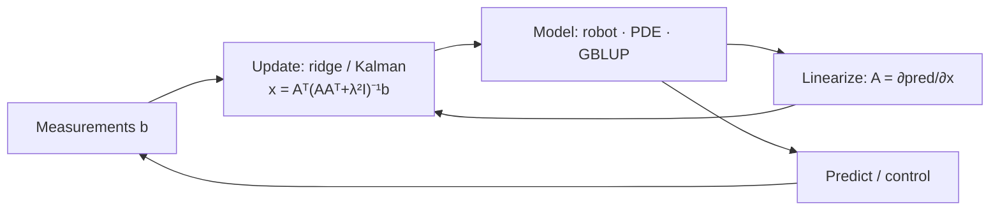

# E · Learning & differentiable glue

Track E Builds on: M4, M5, M7, Track C Hardware: all (SO-ARM101, Crazyflie, rover, turntable)

> **Hook:** Inverse kinematics, GBLUP, bundle adjustment, the Kalman filter and PDE inverse problems are one equation with different names on the variables — solve "fit the data, but don't go wild": \(\min_x \lVert Ax-b\rVert^2 + \lambda^2\lVert x\rVert^2\).

## Intuition first

**One master key.** A building has many doors with different signs: "IK," "GBLUP," "Bundle adjustment," "Kalman," "Inverse PDE." It looks like you need five keys. You need one. The key is *regularized least squares*; each door only changes what is written on the three parts of the lock:

- \(A\) — how a small change in the unknowns moves the prediction (a Jacobian, a marker matrix, a sensitivity).
- \(x\) — the unknowns (joint steps, marker effects, camera poses, link masses, a diffusion field).
- \(b\) — what you measured minus what you predicted (tip error, phenotypes, pixel residuals).

The page follows the key through four doors:

1. **The lock** — normal equations, ridge, Gauss–Newton, Levenberg–Marquardt, in one notation (Part 1).
2. **Why the key has a handle λ** — the Bayesian view: λ is a prior; the inverse is a posterior covariance (Part 2).
3. **Turning the key backward** — the transpose \(A^\top\) carries sensitivities back: \(\tau = J^\top\mathcal F\), the adjoint method, and backprop (Part 3).
4. **A door in your own lab** — identifying the SO-ARM101's link masses is ridge regression (Part 4), then physics-informed learning, operator learning and digital twins (Part 5).

## Problem → math basic → move → result

1. **Problem.** Each lab (robotics, DiffSim/FVEM, Genomics, 3D vision) teaches "its own" solver, with its own letters, and the links stay hidden.
2. **Math basic.** Linearize: near a guess, prediction ≈ \(A x\). Minimize squared misfit plus a penalty on \(x\).
3. **Move.** Set the gradient to zero → \((A^\top A + \lambda^2 I)x = A^\top b\). Look at it through the SVD: every method is a set of *filter factors* on singular values.
4. **Result.** One equation and one knob λ. You can read a new method by asking: what are \(A\), \(x\), \(b\), and what plays the role of λ?

## Part 1 — The least-squares family in one notation

**Normal equations.** Minimize \(\tfrac12\lVert Ax-b\rVert^2\). The gradient is \(A^\top(Ax-b)\); set it to zero:

\[
A^\top A\,x = A^\top b \quad\Longrightarrow\quad x = (A^\top A)^{-1}A^\top b
\]

*Why this move:* at the minimum, the residual \(Ax-b\) is orthogonal to every column of \(A\) — no direction in "prediction space" can reduce it further.

**Ridge / Tikhonov.** When \(A^\top A\) is nearly singular (a 3R arm near full stretch, 200 markers for 40 plants), add a penalty:

\[
\min_x\ \tfrac12\lVert Ax-b\rVert^2 + \tfrac{\lambda^2}{2}\lVert x\rVert^2 \quad\Longrightarrow\quad \boxed{\ x_\lambda = (A^\top A + \lambda^2 I)^{-1}A^\top b = A^\top(AA^\top + \lambda^2 I)^{-1}b\ }
\]

*Why this move:* the second form (push-through identity) inverts the *small* matrix. For IK, \(JJ^\top\) is \(6\times6\) however many joints; for GBLUP, \(XX^\top = G\) is \(n\times n\) lines however many markers. That is exactly why GBLUP works on the kinship matrix.

**Through the SVD** \(A = \sum_i \sigma_i u_i v_i^\top\):

\[
x_\lambda = \sum_i \underbrace{\frac{\sigma_i^2}{\sigma_i^2+\lambda^2}}_{f_i\ \text{(filter factor)}}\ \frac{u_i^\top b}{\sigma_i}\ v_i
\]

*Why this move:* plain least squares divides by \(\sigma_i\); a tiny \(\sigma_i\) blows noise up. The filter factor \(f_i\) is ≈1 when \(\sigma_i \gg \lambda\) (keep) and ≈0 when \(\sigma_i \ll \lambda\) (drop). The **effective number of parameters** is \(\sum_i f_i\) — the same "\(\mathrm{tr}(H)\)" as the hat-matrix trace in M1's bridge table.

**Gauss–Newton** for a nonlinear model \(r(x) = y - f(x)\): linearize with \(A = \partial f/\partial x\), take \(b = r\), solve for a step \(\Delta x\), repeat.

**Levenberg–Marquardt (LM)** = Gauss–Newton + ridge on the step:

\[
(A^\top A + \lambda^2 I)\,\Delta x = A^\top r
\]

λ small → Gauss–Newton (fast near the answer); λ large → \(\Delta x \approx A^\top r/\lambda^2\), a short gradient-descent step (safe far away). Damped-least-squares IK in M5 is LM on the tip-error function.

| Door | \(A\) | \(x\) | \(b\) | λ² means | Lab |
|---|---|---|---|---|---|
| Damped IK step | \(J_b(\theta)\) or \(J_s(\theta)\) | \(\Delta\theta\) | twist error \(\mathcal V_e\) | damping near singularities | M5 |
| Ridge / GBLUP | marker matrix \(X\) | marker effects \(\beta\) | phenotypes \(y\) | \(\sigma_e^2/\sigma_\beta^2\) | Genomics-Lab |
| Bundle adjustment (LM) | reprojection Jacobian | \(\Delta\)(poses, points) | pixel residuals | LM trust-region damping | 3D vision |
| Kalman update / BLUP | \(H\) | state \(x\) | innovation \(y - H\hat x\) | \(R\) vs prior \(P\) (matrix-valued λ) | Track C |
| PDE inverse problem | sensitivity \(\partial u/\partial p\) | parameter field \(p\) | sensor data − model | smoothness prior | DiffSim / FVEM |
| Robot system ID | regressor \(Y(\theta,\dot\theta,\ddot\theta)\) | inertial params \(\pi\) | measured torques \(\tau\) | prior from CAD | Part 4 |

Try: on **IK step**, drag log λ from −3 to 0 and watch the amber arm go from a wild one-step jump to a short safe step — while the 15-step green arm still reaches (push past 0 and even 15 steps fall short). Switch to **GBLUP / ridge**: the blue test curve is lowest near the green line λ = σₑ/σ_b = 1. Switch to **LM**: tiny λ diverges, mid λ converges. The L-curve and filter-factor bars behave the same in all three.

??? question "What if we didn't regularize at all (λ = 0)?"
    In GBLUP with 200 markers and 40 lines, \(X^\top X\) has rank ≤ 40: infinitely many \(\beta\) fit the training data *exactly* (train MSE = 0 in the widget) and test error is worst. In IK, near a singularity the smallest σ is ≈0.1 in the widget, so the 0.95 tip error asks for a ≈137° joint jump (2.39 rad). In LM, λ = 0 is pure Gauss–Newton, which can overshoot from a bad start. Same disease, three symptoms.

## Part 2 — The Bayesian view: λ is a prior

Assume Gaussian noise and a Gaussian prior:

\[
b = Ax + e,\quad e\sim\mathcal N(0,\sigma_e^2 I),\qquad x\sim\mathcal N(0,\sigma_x^2 I)
\]

Then \(-\log p(x\mid b) = \tfrac{1}{2\sigma_e^2}\lVert Ax-b\rVert^2 + \tfrac{1}{2\sigma_x^2}\lVert x\rVert^2 + \text{const}\). Multiply by \(\sigma_e^2\):

\[
\lambda^2 = \frac{\sigma_e^2}{\sigma_x^2},\qquad \hat x_\text{MAP} = x_\lambda,\qquad \operatorname{Cov}(x\mid b) = \sigma_e^2\,(A^\top A + \lambda^2 I)^{-1}
\]

*Why this move:* the regularizer is not a hack — it is your belief about \(x\) before data. In GBLUP, \(\lambda^2 = \sigma_e^2/\sigma_\beta^2\) comes from heritability; REML estimates it. (It equals \(\sigma_e^2/\sigma_g^2\) when markers are scaled so \(G = XX^\top\) has unit diagonal, as in the widget.) The matrix you invert is the **posterior precision**; its inverse is the error bar. LM's damping, IK's damping and the Kalman gain are the same balance of "trust data" vs "trust prior."

**Kalman = BLUP.** With prior \(x\sim\mathcal N(\hat x, P)\) and measurement \(y = Hx + v\), \(v\sim\mathcal N(0,R)\):

\[
\hat x^+ = \hat x + PH^\top(HPH^\top + R)^{-1}(y - H\hat x)
\]

This is the push-through form of ridge with a matrix-valued λ. Henderson's mixed-model equations give the same answer for genetic values.

??? warning "The prior must be in the right units"
    \(\lVert x\rVert^2\) adds radians to metres (IK with mixed joints) or link masses to inertias (system ID). Scale each unknown first, or use a weighted prior \(x^\top\Sigma_x^{-1}x\). In GBLUP, standardizing markers is this step.

## Part 3 — Differentiable glue: the transpose carries sensitivities backward

Three facts you have met separately:

| Where | Forward map | Backward (transpose) map |
|---|---|---|
| Statics (M4) | \(\mathcal V = J\dot\theta\) | \(\tau = J^\top\mathcal F\) |
| Adjoint method (DiffSim) | \(K(p)u = f\), \(\delta u = -K^{-1}(\partial_p K\,u)\delta p\) | solve \(K^\top\lambda_\text{adj} = \partial L/\partial u\), then \(\nabla_p L = -\lambda_\text{adj}^\top(\partial_p K)u\) |
| Backprop (ML) | \(z_{l+1} = \sigma(W_l z_l)\) | \(\bar z_l = W_l^\top(\sigma'\odot\bar z_{l+1})\) |

*Why this move:* for any loss \(L(y)\) with \(y = g(x)\), \(\nabla_x L = (\partial g/\partial x)^\top\nabla_y L\). Forward, the Jacobian pushes *small motions* from inputs to outputs; backward, its transpose pulls *sensitivities* (forces, adjoint variables, gradients) from outputs to inputs. The cost of one backward pass is about one forward pass, whatever the number of parameters — that is why a DiffSim inverse problem with 10⁵ parameters is affordable.

Note \(A^\top b\) on the right side of every normal equation: that term *is* one backward pass. Gauss–Newton = one forward linearization + one adjoint.

**Differentiable simulation** puts the robot's dynamics \(M(\theta)\ddot\theta + c(\theta,\dot\theta) + g(\theta) = \tau\) (M7) inside the loss, so gradients flow from "the gripper missed by 2 cm" back to masses, friction or controller gains. Contact is the hard part: it is non-smooth, so gradients need smoothing.

## Part 4 — System identification of a robot is ridge regression

The rigid-body dynamics of any open chain are **linear in the inertial parameters**. For each link \(i\), stack 10 numbers: mass \(m_i\), first moments \(m_i c_i\) (3), and 6 inertia entries (taken about the link-frame origin, not the CoM — that is what keeps them linear). Then

\[
\tau = M(\theta)\ddot\theta + c(\theta,\dot\theta) + g(\theta) = Y(\theta,\dot\theta,\ddot\theta)\,\pi,\qquad \pi\in\R^{10n}
\]

*Why this move:* kinetic energy \(\tfrac12\mathcal V_i^\top\mathcal G_i\mathcal V_i\) is linear in the spatial inertia \(\mathcal G_i\), and gravity potential is linear in \(m_i c_i\). The Lagrangian, and so every torque, is a linear combination of these 10n numbers. All nonlinearity goes into the **regressor** \(Y\), which depends only on measured motion.

Record \(K\) samples along an exciting trajectory and stack them:

\[
\underbrace{\begin{bmatrix}\tau_1\\ \vdots\\ \tau_K\end{bmatrix}}_{b} = \underbrace{\begin{bmatrix}Y_1\\ \vdots\\ Y_K\end{bmatrix}}_{A}\pi \quad\Longrightarrow\quad \hat\pi = (A^\top A + \lambda^2 I)^{-1}(A^\top b + \lambda^2\pi_\text{CAD})
\]

*Why this move:* shrinking toward the CAD estimate \(\pi_\text{CAD}\) instead of zero is ridge with a prior mean — exactly how a GBLUP model shrinks toward the population mean. Some combinations of \(\pi\) never affect \(\tau\) (zero singular values); they are the "unidentifiable" parameters, and the prior picks them.

**Trajectory design = design of experiments.** A good trajectory makes \(A\) well-conditioned (large smallest \(\sigma_i\)) — the same goal as choosing a training population that spans genetic space.

??? question "What if we fit masses with a neural net instead?"
    You lose the guarantee that the result is a real body: positive mass, positive-definite inertia. The linear form lets you add those as convex constraints (linear matrix inequalities) and keep a unique answer. A neural residual on top of \(Y\pi\) (a "gray-box" model) keeps both.

## Part 5 — Physics-informed learning, operator learning, digital twins

The same lock, bigger doors:

- **Physics-informed learning.** Add the PDE residual to the loss: \(\mathcal L = \lVert u_\phi - u_\text{data}\rVert^2 + \lambda^2\lVert\mathcal N[u_\phi]\rVert^2\). The physics term is a regularizer — Tikhonov with a PDE instead of \(\lVert x\rVert^2\).
- **Operator learning.** Learn \(\mathcal G_\phi: p \mapsto u\) for *all* parameters at once (DeepONet, FNO; FVEM Part 4). Then an inverse problem becomes LM through a fast surrogate: \(A = \partial\mathcal G_\phi/\partial p\) by autodiff.
- **Digital twins.** A twin = model + data assimilation running continuously: each new measurement is a Kalman/BLUP update (Part 2) of the twin's state and parameters, and each decision is optimized through the differentiable model (Part 3). A robot twin uses Part 4's \(\hat\pi\); a field twin uses crop-model and genomic parameters.

## Math bridges

| Here | DiffSim / FVEM | Genomics-Lab | 3D vision |
|---|---|---|---|
| \(x_\lambda=(A^\top A+\lambda^2I)^{-1}A^\top b\) | Tikhonov-regularized inverse problem | ridge regression / rrBLUP | LM step in bundle adjustment |
| Push-through: \(A^\top(AA^\top+\lambda^2I)^{-1}b\) | data-space (representer) form of inversion | GBLUP: invert \(G+\lambda^2 I\) (lines × lines) | — |
| \(\lambda^2=\sigma_e^2/\sigma_x^2\), posterior covariance | Bayesian inversion, UQ (FVEM Bayes/UQ page) | \(\lambda^2=\sigma_e^2/\sigma_g^2\) from heritability; REML | pose covariance from \(H^{-1}\) |
| \(\tau=J^\top\mathcal F\), \(\nabla_x L=(\partial g/\partial x)^\top\nabla_yL\) | adjoint method, [DiffSim-Lab](https://znjubery.github.io/DiffSim-Lab/) | gradient of the REML likelihood | backprop through NeRF / 3DGS renderer |
| \(\tau=Y(\theta,\dot\theta,\ddot\theta)\pi\) | linear-in-parameters FE models: \(K(p)=\sum p_iK_i\) | \(y=X\beta+e\), the same linear model | — |
| Physics-informed loss | PINNs; [FVEM](https://github.com/znjubery/fvem) Parts 4–7 (operator learning, hybrid SciML) | biology-informed priors on effects | NeRF with geometry / depth priors |

## In your robots

| Where | What this track gives you |
|---|---|
| **SO-ARM101** | Identify \(\pi\) (5 links × 10 = 50 parameters, many unidentifiable) from joint-position and motor-current logs along an exciting trajectory; ridge toward CAD values. Gives better gravity compensation and a better simulator for Track D. |
| **Crazyflie** | Identify mass and thrust coefficient from hover thrust vs battery voltage: a 2-parameter linear least-squares fit. |
| **Rover** | Wheel radius and track width from logged wheel speeds and a measured path: linear in \((r, r/W)\). |
| **ComXim turntable + SfM** | Bundle adjustment is LM; fixing the known turntable axis (M2) is a strong prior that shrinks the unknowns. |
| **Genomics / Plot Builders** | Same solver, different \(A\): GBLUP for traits; LM to fit plant-model parameters (leaf angle, internode length) to a 3D scan. |

## Current research

- **Bayesian robot identification.** [Reiners et al., 2025](https://arxiv.org/abs/2506.19350) estimate an industrial robot's dynamic (inertial) parameters with Bayesian statistics and prior knowledge, giving physically plausible values with confidence intervals — Part 2 + Part 4 in practice.
- **Physical consistency.** [Wensing et al.](https://arxiv.org/pdf/1701.04395) give linear-matrix-inequality constraints that keep identified inertias physically real, while staying convex.
- **Differentiable simulation for system ID.** [Chen et al., 2025](https://arxiv.org/html/2410.03920v2) recover object mass and elastic moduli from robot joint encoders alone by fitting a differentiable robot–object simulation; [RigPI](https://arxiv.org/pdf/2606.25212) seeds differentiable-simulation identification with a vision-language model's guess.
- **Operator learning for inverse problems.** [DeepONet-accelerated Bayesian inversion](https://arxiv.org/pdf/2512.20268) and [generalizable neural operators for inverse problems](https://arxiv.org/pdf/2512.18120) replace the PDE solve inside the inversion loop with a learned surrogate.
- **Digital twins need this math.** The [MATH-DT report](https://arxiv.org/pdf/2402.10326) names inverse problems, UQ and data assimilation as the core open math of digital twins.

## Challenges

1. **Choosing λ.** L-curve corner, cross-validation and REML can disagree by 10×; the widget's GBLUP test error is flat over roughly λ ∈ [1, 10].
2. **Scale.** \(A^\top A\) for 10⁶ markers or 10⁵ BA points can't be formed; you need iterative solvers (CG, LSQR) that only use \(Av\) and \(A^\top w\) — one forward and one adjoint pass each.
3. **Nonlinearity and local minima.** LM and Gauss–Newton only find the nearest minimum; the widget's LM at λ ≈ 0.03 wanders off to a wrong fit.
4. **Non-smooth physics.** Contact and friction make \(A\) discontinuous, so gradients through differentiable simulators are noisy or wrong.
5. **Excitation.** System ID needs trajectories that excite all identifiable parameters; on a 5-DOF hobby arm with weak motors, many of the 50 parameters stay poorly determined.

## Next five years

- **One autodiff stack for everything**: robot dynamics, PDE solvers, renderers and genomic models in the same JAX/PyTorch graph, with adjoints for free.
- **Learned priors replacing \(\lambda^2 I\)**: diffusion models as priors for inverse problems (images, fields, poses).
- **Self-calibrating robots** that run system ID continuously as a background Kalman/LM update.
- **Ag/phenotyping:** field digital twins that assimilate drone, rover and sensor data into crop-model + genomic-prediction parameters with honest uncertainty, using exactly the ridge/Kalman machinery on this page.

## Check yourself

A singular value equals λ. Its filter factor in ridge regression is:

<ol><li data-k="a">0</li><li data-k="b">0.5</li><li data-k="c">1</li><li data-k="d">λ²</li></ol>

In the Bayesian view of ridge regression, λ² equals:

<ol><li data-k="a">the number of parameters</li><li data-k="b">σₓ²/σₑ²</li><li data-k="c">the smallest singular value</li><li data-k="d">σₑ²/σₓ², noise variance over prior variance</li></ol>

Why is identifying a robot's link masses and inertias a linear least-squares problem?

<ol><li data-k="a">The dynamics are linear in the inertial parameters, even though they are nonlinear in θ</li><li data-k="b">The robot moves slowly</li><li data-k="c">The mass matrix is diagonal</li><li data-k="d">Gravity can be ignored</li></ol>

One line: IK, GBLUP, bundle adjustment, Kalman filtering, robot system ID and PDE inverse problems all open with one key — x = (AᵀA + λ²I)⁻¹Aᵀb, where λ² is your prior and Aᵀ carries sensitivities backward.

**Carries over to:** [M4](m04-velocity-kinematics.md) (Jacobian and τ = Jᵀ𝓕), [M5](m05-inverse-kinematics.md) (damped least-squares IK), [M7](m07-dynamics.md) (dynamics behind the regressor), [Track C](t-c-rover-estimation.md) (Kalman filter), [Track D](t-d-physical-ai.md) (behavior cloning as regression, sim2real), [Math bridges](connections.md).
